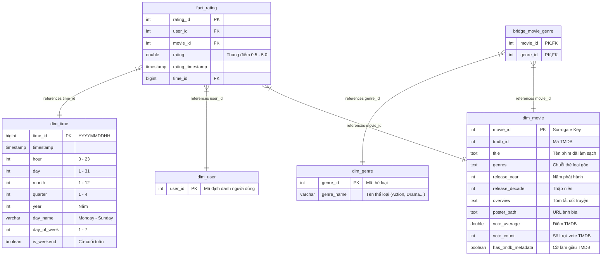

# BÁO CÁO CHI TIẾT ĐỒ ÁN TỐT NGHIỆP / CUỐI KỲ
## HỆ THỐNG NỀN TẢNG DỮ LIỆU TOÀN DIỆN, KHO DỮ LIỆU DOANH NGHIỆP, KINH DOANH THÔNG MINH VÀ GỢI Ý ĐIỆN ẢNH THÔNG MINH
### (End-to-End Data Lake, Data Warehouse, Apache Airflow, Power BI & Hybrid Machine Learning Recommender)

---

## MỤC LỤC
1. [TỔNG QUAN HỆ THỐNG & KIẾN TRÚC TOÀN CẢNH (ARCHITECTURE OVERVIEW)](#1-tổng-quan-hệ-thống--kiến-trúc-toàn-cảnh)
2. [TẦNG 1: NGUỒN DỮ LIỆU (DATA SOURCES LAYER)](#2-tầng-1-nguồn-dữ-liệu-data-sources-layer)
3. [TẦNG 2: HỒ DỮ LIỆU THÔ (DATA LAKE LAYER - MINIO S3)](#3-tầng-2-hồ-dữ-liệu-thô-data-lake-layer---minio-s3)
4. [TẦNG 3: ĐIỀU PHỐI TỰ ĐỘNG PIPELINE (ORCHESTRATION LAYER - APACHE AIRFLOW)](#4-tầng-3-điều-phối-tự-động-pipeline-orchestration-layer---apache-airflow)
5. [TẦNG 4: ĐỘNG CƠ ETL VÀ TIỀN XỬ LÝ (ETL ENGINE & STAGING LAYER)](#5-tầng-4-động-cơ-etl-và-tiền-xử-lý-etl-engine--staging-layer)
6. [TẦNG 5: KHO DỮ LIỆU DOANH NGHIỆP (DATA WAREHOUSE LAYER - POSTGRESQL & STAR SCHEMA)](#6-tầng-5-kho-dữ-liệu-doanh-nghiệp-data-warehouse-layer---postgresql--star-schema)
7. [TẦNG 6: BÁO CÁO KINH DOANH THÔNG MINH (BUSINESS INTELLIGENCE LAYER - POWER BI)](#7-tầng-6-báo-cáo-kinh-doanh-thông-minh-business-intelligence-layer---power-bi)
8. [TẦNG 7: HỆ THỐNG GỢI Ý ĐIỆN ẢNH THÔNG MINH (MACHINE LEARNING RECOMMENDER - LIGHTFM & WARP)](#8-tầng-7-hệ-thống-gợi-ý-điện-ảnh-thông-minh-machine-learning-recommender---lightfm--warp)
9. [HẠ TẦNG VẬN HÀNH & DEVOPS (DOCKER & CONTAINERIZATION)](#9-hạ-tầng-vận-hành--devops-docker--containerization)
10. [HƯỚNG DẪN VẬN HÀNH TOÀN DIỆN TỪ A-Z (OPERATION MANUAL)](#10-hướng-dẫn-vận-hành-toàn-diện-từ-a-z-operation-manual)
11. [BẢNG TỔNG HỢP CÔNG NGHỆ & ĐỊNH HƯỚNG PHÁT TRIỂN](#11-bảng-tổng-hợp-công-nghệ--định-hướng-phát-triển)

---

## 1. TỔNG QUAN HỆ THỐNG & KIẾN TRÚC TOÀN CẢNH

Dự án xây dựng một hệ thống nền tảng dữ liệu hiện đại (**Modern Data Platform**) đạt chuẩn doanh nghiệp, tích hợp hoàn chỉnh 4 trụ cột công nghệ dữ liệu:
1. **Data Engineering (Kỹ thuật dữ liệu)**: Thu thập đa nguồn, lưu trữ Data Lake chuẩn S3, điều phối tự động qua DAG Workflow, làm sạch và chuẩn hóa ETL.
2. **Data Warehousing (Kho dữ liệu)**: Thiết kế lược đồ hình sao (Star Schema) tối ưu hóa truy vấn phân tích (OLAP), toàn vẹn ràng buộc khóa và quan hệ cầu nhiều - nhiều.
3. **Business Intelligence (Kinh doanh thông minh)**: Xây dựng báo cáo trực quan tương tác đa chiều trên Microsoft Power BI với hệ thống chỉ số đo lường DAX.
4. **Machine Learning / Artificial Intelligence (Học máy & Trí tuệ nhân tạo)**: Xây dựng hệ thống gợi ý phim cá nhân hóa kết hợp (Hybrid Recommender) dựa trên thuật toán LightFM với hàm mất mát xếp hạng WARP và cơ chế Fallback xử lý bài toán Cold-Start.

### Sơ đồ Kiến trúc Tổng quan Hệ thống (System Architecture)

```mermaid
flowchart LR
    %% ========================================================
    %% 1. NGUỒN DỮ LIỆU
    %% ========================================================
    subgraph SOURCELAYER ["1. Data Source (Nguồn Dữ Liệu)"]
        direction TB
        TMDB["The Movie Database (TMDB)<br/>(REST API / JSON Metadata)"]
    end

    %% ========================================================
    %% 2. INGESTION & DATA LAKE
    %% ========================================================
    subgraph INGESTLAYER ["2. Ingestion & Data Lake (Hồ Dữ Liệu Thô)"]
        direction TB
        INGEST["ingest_to_minio.py<br/>fetch_raw_data.py"]
        MINIO[("MinIO Data Lake (S3 API)<br/>bucket: raw-datalake<br/>Port 9000 / 9001")]
        RAW_LOCAL[("Local Raw Storage<br/>raw_data/")]
    end

    %% ========================================================
    %% 3. ETL ENGINE & STAGING
    %% ========================================================
    subgraph ETLLAYER ["3. ETL Engine & Staging (Xử Lý & Chuẩn Hóa)"]
        direction TB
        STAGING["Staging Area (staging/)<br/>• Trích xuất năm/thập niên từ title<br/>• Khử trùng lặp cặp (user_id, movie_id)<br/>• Chuẩn hóa grain giờ (%Y%m%d%H)<br/>• Tách thể loại & sinh bảng cầu nối N-N<br/>• Làm giàu thông tin & cờ has_tmdb_metadata"]
    end

    %% ========================================================
    %% 4. KHO DỮ LIỆU DATA WAREHOUSE (OLAP)
    %% ========================================================
    subgraph DWLAYER ["4. PostgreSQL Data Warehouse (OLAP - Port 5434)"]
        direction TB
        subgraph STAR_SCHEMA ["Mô Hình Hình Sao Mở Rộng (Star Schema + Bridge Table)"]
            direction TB
            DIMS["Các Bảng Chiều (Dimensions)<br/>• dim_user (610 users)<br/>• dim_movie (9.742 movies)<br/>• dim_genre (19 genres)<br/>• dim_time (7.761 hours)"]
            BMG["Bảng Cầu Nối (Bridge Table)<br/>• bridge_movie_genre (22.050 records)<br/>PK/FK: (movie_id, genre_id)"]
            FR["Bảng Sự Kiện (Fact Table)<br/>• fact_rating (100.836 ratings)<br/>PK: (user_id, movie_id) • FK: time_id"]
        end
    end

    %% ========================================================
    %% 5. DATA QUALITY GATE
    %% ========================================================
    subgraph DQLAYER ["5. Data Quality Gate (Kiểm Định Chất Lượng)"]
        direction TB
        DQ["Kiểm Định Tự Động<br/>• 0 bảng rỗng (> 0 records)<br/>• 0 Orphan Records (Toàn vẹn FK)<br/>• Uniqueness PK & NOT NULL<br/>• Rating hợp lệ: 0.5 <= rating <= 5.0<br/>• Upsert Idempotent an toàn"]
    end

    %% ========================================================
    %% 6. SERVICE LAYER (TẦNG DỊCH VỤ & ỨNG DỤNG)
    %% ========================================================
    subgraph SERVINGLAYER ["6. Service Layer (Tầng Dịch Vụ & Ứng Dụng)"]
        direction TB
        subgraph BI ["Business Intelligence"]
            PBI["Power BI Dashboard<br/>(MovieLens_TMDB_BI.pbix)"]
        end
        subgraph ML ["Machine Learning & RecSys"]
            ML_TEST["File Test Truy Vấn & Đánh Giá<br/>(run_ml.bat / recommend.py)"]
            LFM["Hybrid LightFM (WARP Loss)"]
            BASELINE["Most Popular Fallback Engine"]
        end
    end

    %% ========================================================
    %% 7. HỆ THỐNG ĐIỀU PHỐI (APACHE AIRFLOW)
    %% ========================================================
    subgraph ORCHESTRATION ["Điều Phối Tự Động (Apache Airflow • Port 8080)"]
        AF_DAG["DAG: movielens_data_warehouse_etl (@daily)<br/>Task 1: Ingest ➔ Task 2: Extract ➔ Task 3: Transform ➔ Task 4: Load Dims ➔ Task 5: Load Fact ➔ Task 6: Validate"]
    end

    %% LUỒNG DỮ LIỆU TUẦN TỰ TỪ TRÁI SANG PHẢI (CHẠY NGANG)
    TMDB --> INGEST
    INGEST --> MINIO
    INGEST -.-> RAW_LOCAL

    MINIO --> STAGING
    RAW_LOCAL -.-> STAGING

    STAGING --> DIMS
    STAGING --> BMG
    STAGING --> FR

    DIMS --> DQ
    BMG --> DQ
    FR --> DQ

    DQ --> BI
    DQ --> ML

    %% LIÊN KẾT ĐIỀU PHỐI AIRFLOW
    AF_DAG -.->|Điều phối tự động 6 tasks| INGESTLAYER
    AF_DAG -.->|Điều phối tự động 6 tasks| ETLLAYER
    AF_DAG -.->|Điều phối tự động 6 tasks| DWLAYER
    AF_DAG -.->|Điều phối tự động 6 tasks| DQLAYER
```



---

## 2. TẦNG 1: NGUỒN DỮ LIỆU (DATA SOURCES LAYER)

### 2.1. Tập dữ liệu MovieLens 100K (Academic Benchmark)
* **Khái niệm**: MovieLens là tập dữ liệu nghiên cứu chuẩn mực học thuật được thu thập và phát triển bởi nhóm nghiên cứu GroupLens thuộc Đại học Minnesota (Hoa Kỳ).
* **Đặc điểm kỹ thuật**:
  * Gồm 100.836 lượt đánh giá xếp hạng (`ratings`) từ thang điểm `0.5` đến `5.0` (bước nhảy `0.5`).
  * Được đóng góp bởi **610 người dùng** (`dim_user`) trên tổng số **9.742 bộ phim** (`dim_movie`).
  * Tất cả người dùng trong tập dữ liệu đều đã đánh giá tối thiểu 20 bộ phim (giảm thiểu tình trạng thưa thớt ma trận cực đoan).
  * Định dạng dữ liệu thô: Các file CSV có cấu trúc (`movies.csv`, `ratings.csv`, `links.csv`, `tags.csv`).

### 2.2. The Movie Database (TMDB) REST API
* **Khái niệm**: TMDB là một trong những cơ sở dữ liệu điện ảnh trực tuyến mở lớn nhất thế giới, cung cấp giao diện lập trình ứng dụng RESTful API để truy xuất siêu dữ liệu (metadata) của phim ảnh.
* **Vai trò trong hệ thống (Data Enrichment)**:
  * File `links.csv` từ MovieLens cung cấp khóa ngoại ánh xạ `movieId -> tmdbId`.
  * Hệ thống kết nối tới TMDB API để làm giàu các trường thông tin mà MovieLens còn thiếu:
    * `overview`: Văn bản tóm tắt nội dung cốt truyện của phim (yếu tố sống còn để trích xuất đặc trưng văn bản cho Content-based Filtering).
    * `poster_path`: Đường dẫn ảnh bìa phim phục vụ trực quan hóa trên giao diện BI.
    * `vote_average` và `vote_count`: Điểm đánh giá toàn cầu và số lượt bình chọn từ cộng đồng TMDB.
  * Định dạng lưu trữ: `tmdb_movies_raw.json` (dữ liệu bán cấu trúc Semi-structured JSON).

---

## 3. TẦNG 2: HỒ DỮ LIỆU THÔ (DATA LAKE LAYER - MINIO S3)

### 3.1. Khái niệm Data Lake và sự khác biệt với Data Warehouse
* **Data Lake (Hồ dữ liệu)**: Là kho lưu trữ trung tâm cho phép chứa khối lượng khổng lồ mọi loại dữ liệu ở định dạng nguyên bản (Raw format - Structured, Semi-structured, Unstructured). Tuân thủ nguyên lý **ELT (Extract - Load - Transform)**: Tải dữ liệu vào trước, khi nào cần dùng mới phân tích cú pháp và chuyển đổi (**Schema-on-Read**).
* **So sánh Data Lake vs Data Warehouse**:
  * *Data Lake*: Linh hoạt, chi phí lưu trữ thấp, lưu trữ dữ liệu thô không giới hạn, bảo vệ dữ liệu gốc nguyên vẹn để có thể chạy lại bất kỳ logic ETL nào trong tương lai.
  * *Data Warehouse*: Dữ liệu đã qua làm sạch sâu, chuẩn hóa cấu trúc (**Schema-on-Write**), tối ưu hóa tốc độ truy vấn phân tích chỉ số kinh doanh (SQL OLAP).

### 3.2. Công nghệ MinIO Object Storage
* **Bản chất**: MinIO là một máy chủ lưu trữ đối tượng (Object Storage) mã nguồn mở tương thích 100% với chuẩn giao thức Amazon S3 API. MinIO được viết bằng ngôn ngữ Go, có tốc độ đọc ghi cực cao và khả năng mở rộng quy mô lớn (Cloud-native).
* **Cấu hình triển khai trong dự án**:
  * **Image**: `cgr.dev/chainguard/minio:latest` (Đảm bảo an toàn bảo mật, loại bỏ lỗ hổng CVE).
  * **Bucket**: `raw-datalake`
  * **Phân vùng logic (Logical Partitioning)**:
    * `raw-datalake/movielens/`: Chứa các bản snapshot thô CSV (`movies.csv`, `ratings.csv`, `links.csv`, `tags.csv`).
    * `raw-datalake/tmdb/`: Chứa file JSON thô phản hồi từ API TMDB (`tmdb_movies_raw.json`).
  * **Cổng dịch vụ**:
    * Port `9000`: S3 API Endpoint dành cho các ứng dụng và script kết nối.
    * Port `9001`: Web Console UI trực quan cho Quản trị viên duyệt file, kiểm tra bucket.

---

## 4. TẦNG 3: ĐIỀU PHỐI TỰ ĐỘNG PIPELINE (ORCHESTRATION LAYER - APACHE AIRFLOW)

### 4.1. Khái niệm Data Pipeline Orchestration
Trong các hệ thống sản xuất lớn, dữ liệu không thể xử lý thủ công hay bằng các cronjob phân mảnh rời rạc. Orchestration (Điều phối quy trình) là công nghệ tự động hóa chuỗi công việc, quản lý thứ tự phụ thuộc (Dependencies), tự động thử lại khi lỗi (Retry), theo dõi thời gian thực (Monitoring), và lưu trữ lịch sử trạng thái thực thi.

### 4.2. Các thành phần cốt lõi của Apache Airflow
* **DAG (Directed Acyclic Graph)**: Đồ thị có hướng không có chu trình. Trong Airflow, một DAG đại diện cho một luồng công việc hoàn chỉnh, trong đó các đỉnh là Task và các cạnh là quan hệ phụ thuộc trước-sau.
* **Task & Operator**: Một Task là một đơn vị công việc được định nghĩa bởi một Operator (trong dự án sử dụng `PythonOperator` thực thi các hàm xử lý Python tối ưu).
* **Airflow Scheduler**: Trái tim của Airflow, liên tục kiểm tra thời gian và trạng thái của các DAG, quyết định khi nào một Task đủ điều kiện chạy và đẩy vào hàng đợi thực thi.
* **Airflow Webserver**: Giao diện người dùng Web trực quan (chạy tại cổng `http://localhost:8080`), cho phép kích hoạt DAG thủ công, xem sơ đồ Graph View, Grid View, Gantt chart và theo dõi chi tiết log của từng Task.
* **Airflow Metadata Database**: Cơ sở dữ liệu PostgreSQL lưu trữ toàn bộ thông tin nội bộ của Airflow: tài khoản, phân quyền, biến môi trường (Variables), kết nối (Connections), lịch sử các lần chạy DAG Run và Task Instance.
* **LocalExecutor**: Bộ thực thi đa luồng/đa tiến trình nội bộ container, cho phép các Task độc lập chạy song song để tối ưu hóa tài nguyên phần cứng.

### 4.3. Thiết kế DAG `movielens_data_warehouse_etl`
Pipeline được lập lịch tự động `@daily` với chuỗi 6 bước tuần tự nghiêm ngặt:

```text
[Task 1: ingest_raw_to_minio]
         │ (Tải dữ liệu thô MovieLens & TMDB đẩy lên MinIO Data Lake)
         ▼
[Task 2: extract_from_minio]
         │ (Tải đối tượng thô từ MinIO về môi trường xử lý nội bộ)
         ▼
[Task 3: clean_and_transform]
         │ (Làm sạch dữ liệu, chuẩn hóa title/năm, phân tích genres, lưu Staging)
         ▼
[Task 4: load_dimension_tables]
         │ (Nạp các bảng chiều: dim_user, dim_movie, dim_genre, bridge, dim_time)
         ▼
[Task 5: load_fact_rating]
         │ (Nạp bảng sự kiện fact_rating với các ràng buộc khóa ngoại)
         ▼
[Task 6: validate_data_warehouse]
           (Kiểm tra toàn vẹn: đếm dòng, kiểm tra Orphan Key, phát hiện sai lệch)
```

---

## 5. TẦNG 4: ĐỘNG CƠ ETL VÀ TIỀN XỬ LÝ (ETL ENGINE & STAGING LAYER)

### 5.1. Khái niệm ETL (Extract - Transform - Load)
* **Extract (Trích xuất)**: Đọc dữ liệu từ tầng Data Lake MinIO thông qua giao thức S3 client.
* **Transform (Chuyển đổi & Làm sạch)**: Biến đổi dữ liệu thô, không nhất quán thành dạng cấu trúc chuẩn phục vụ phân tích.
* **Load (Nạp dữ liệu)**: Ghi dữ liệu đã tinh chế vào kho dữ liệu đích (PostgreSQL) thông qua các giao dịch an toàn (ACID Transactions).

### 5.2. Các quy trình làm sạch & chuẩn hóa dữ liệu chi tiết
1. **Khử trùng lặp (Deduplication)**:
   * Một người dùng có thể gửi đánh giá cho cùng một bộ phim nhiều lần tại các thời điểm khác nhau.
   * Hệ thống tự động gom nhóm theo cặp khóa `(user_id, movie_id)` và chỉ giữ lại bản ghi có `timestamp` mới nhất.
2. **Trích xuất thông tin có cấu trúc từ chuỗi phi cấu trúc**:
   * Tiêu đề phim gốc thường chứa năm phát hành ở cuối chuỗi: ví dụ `"Toy Story (1995)"`, `"Heat (1995)"`.
   * Sử dụng biểu thức chính quy (Regex `\s*\((\d{4})\)$`) để tách chuỗi:
     * `title`: Làm sạch thành `"Toy Story"`.
     * `release_year`: Chuyển thành số nguyên `1995`.
     * `release_decade`: Tính toán thập niên `1990` (`1995 // 10 * 10`).
3. **Phân tách thuộc tính đa trị (Multi-valued Attributes) thành mô hình quan hệ**:
   * Trường `genres` ban đầu là chuỗi ghép ngăn cách bởi dấu gạch đứng: `"Action|Adventure|Sci-Fi"`.
   * Tách chuỗi (String Tokenization) thành danh sách thể loại riêng biệt, loại bỏ nhãn `(no genres listed)`.
   * Tạo bảng danh mục chuẩn hóa `dim_genre` và sinh bảng cầu `bridge_movie_genre`.
4. **Chuẩn hóa chiều thời gian (Time Dimension Enrichment)**:
   * Trường `timestamp` từ MovieLens là dạng Unix Epoch (số giây tính từ 01/01/1970).
   * Chuyển đổi thành kiểu `DATETIME` chuẩn và bóc tách thành các thuộc tính phân tích thời gian đa cấp: Giờ (`hour`), Ngày (`day`), Tháng (`month`), Quý (`quarter`), Năm (`year`), Thứ trong tuần (`day_of_week`), Cờ đánh dấu ngày cuối tuần (`is_weekend`).
5. **Vùng đệm Staging Layer**:
   * Dữ liệu sau bước chuyển đổi được lưu trữ tạm thời tại `staging/` dưới định dạng nhị phân nén hiệu năng cao trước khi nạp vào cơ sở dữ liệu, đảm bảo tính cô lập và khả năng khôi phục nhanh nếu xảy ra lỗi mạng.

---

## 6. TẦNG 5: KHO DỮ LIỆU DOANH NGHIỆP (DATA WAREHOUSE LAYER - POSTGRESQL & STAR SCHEMA)

### 6.1. Khái niệm Data Warehouse và OLAP vs OLTP
* **OLTP (Online Transaction Processing)**: Thiết kế cho các ứng dụng nghiệp vụ giao dịch hàng ngày (ngân hàng, thương mại điện tử). Ưu tiên tốc độ ghi dữ liệu (INSERT/UPDATE/DELETE), chuẩn hóa cao độ (3NF) để tránh dư thừa dữ liệu.
* **OLAP (Online Analytical Processing)**: Thiết kế cho Kho dữ liệu phân tích. Dữ liệu được tổ chức phi chuẩn hóa có chủ đích (Denormalization) dưới dạng Lược đồ hình sao (Star Schema) để tối đa hóa tốc độ đọc (SELECT), giảm thiểu số lượng phép JOIN phức tạp khi phân tích hàng triệu dòng dữ liệu.

### 6.2. Thiết kế Lược đồ hình sao (Star Schema) của dự án

Trung tâm của kho dữ liệu là bảng sự kiện **Fact Table** chứa các độ đo số lượng, xung quanh là các bảng chiều **Dimension Tables** mô tả ngữ cảnh phân tích:



### 6.3. Chi tiết các bảng và kỹ thuật giải quyết quan hệ Many-to-Many
* **Bảng cầu `bridge_movie_genre`**:
  * Một bộ phim có thể thuộc nhiều thể loại (ví dụ: *Titanic* vừa là Romance, vừa là Drama). Ngược lại, một thể loại chứa hàng nghìn bộ phim. Đây là quan hệ Nhiều - Nhiều (M:N).
  * Trong thiết kế Data Warehouse chuẩn Kimball, quan hệ M:N không bao giờ được phép để chung chuỗi hay lặp lại dòng trong bảng Fact/Dim. Cần sử dụng một **Bridge Table** chứa cặp khóa `(movie_id, genre_id)` làm khóa chính kép. Nhờ đó, các báo cáo BI có thể phân tích chính xác từng thể loại mà không làm nhân đôi số liệu rating.
* **Số liệu thực tế trong Kho dữ liệu**:
  * `dim_user`: **610** người dùng.
  * `dim_movie`: **9.742** bộ phim.
  * `dim_genre`: **19** thể loại chuẩn.
  * `bridge_movie_genre`: **22.050** bản ghi liên kết thể loại.
  * `dim_time`: **7.761** mốc thời gian chi tiết theo giờ.
  * `fact_rating`: **100.836** bản ghi đánh giá sạch (100% toàn vẹn ràng buộc toàn bộ Foreign Key, 0 lỗi Orphan).

---

## 7. TẦNG 6: BÁO CÁO KINH DOANH THÔNG MINH (BUSINESS INTELLIGENCE LAYER - POWER BI)

### 7.1. Khái niệm Business Intelligence (BI)
BI là tập hợp các công nghệ và quy trình chuyển đổi dữ liệu thô trong Kho dữ liệu thành các thông tin trực quan có giá trị hành động (Actionable Insights), hỗ trợ các nhà quản trị đưa ra quyết định chiến lược dựa trên dữ liệu thực tế (Data-driven Decision Making).

### 7.2. Tích hợp Power BI với PostgreSQL Data Warehouse
* **Phương thức kết nối**: Kết nối trực tiếp cơ sở dữ liệu `localhost:5434` với database `dw_movies` thông qua PostgreSQL Connector.
* **Mô hình hóa dữ liệu (Data Modeling)**:
  * Nạp đầy đủ 6 bảng từ Star Schema.
  * Thiết lập các mối quan hệ 1 - Nhiều (1:*) giữa `dim_movie[movie_id]` -> `fact_rating[movie_id]`, `dim_user[user_id]` -> `fact_rating[user_id]`, `dim_time[time_id]` -> `fact_rating[time_id]`.
  * Thiết lập mối quan hệ lọc hai chiều thông qua `bridge_movie_genre`.

### 7.3. Hệ thống chỉ số đo lường DAX (Data Analysis Expressions)
Trong file báo cáo `MovieLens_TMDB_BI.pbix`, các chỉ số nghiệp vụ được tính toán theo thời gian thực bằng DAX:
1. **Tổng số lượt đánh giá**:
   $$\text{Total Ratings} = \text{COUNTROWS}(\text{fact\_rating})$$
2. **Điểm đánh giá trung bình toàn hệ thống**:
   $$\text{Average Rating} = \text{AVERAGE}(\text{fact\_rating}[\text{rating}])$$
3. **Số lượng phim được đánh giá cao ($\ge 4.0\star$)**:
   $$\text{High Rated Count} = \text{CALCULATE}(\text{COUNTROWS}(\text{fact\_rating}), \text{fact\_rating}[\text{rating}] \ge 4.0)$$
4. **Tỷ lệ yêu thích**:
   $$\text{Approval Rate} = \frac{\text{High Rated Count}}{\text{Total Ratings}}$$

### 7.4. Các màn hình phân tích trực quan (Dashboard Pages)
* **Trang Tổng quan (Executive Overview)**: Card KPIs hiển thị tổng phim, tổng user, tổng rating, biểu đồ phân bố điểm số (Rating Distribution từ 0.5 đến 5 sao).
* **Trang Xu hướng Điện ảnh (Cinema Trends)**: Biểu đồ đường (Line Chart) thể hiện sự thay đổi thị hiếu người xem qua các thập niên (1920 - 2010), số lượng phim phát hành theo năm.
* **Trang Phân tích Thể loại (Genre Deep Dive)**: Biểu đồ thanh (Bar Chart) và biểu đồ Treemap thể hiện thể loại được yêu thích nhất (Drama, Comedy, Action chiếm tỷ trọng áp đảo) và mức điểm trung bình theo thể loại.
* **Trang Top Phim Thịnh Hành (Leaderboards)**: Bảng xếp hạng phim có lượt vote cao nhất, hiển thị kèm poster và thông tin tóm tắt từ TMDB.

---

## 8. TẦNG 7: HỆ THỐNG GỢI Ý ĐIỆN ẢNH THÔNG MINH (MACHINE LEARNING RECOMMENDER - LIGHTFM & WARP)

### 8.1. Các trường phái xây dựng hệ thống gợi ý (Recommendation Paradigms)
1. **Collaborative Filtering (Lọc cộng tác)**:
   * *Nguyên lý*: Dựa trên giả định rằng những người dùng có chung hành vi trong quá khứ sẽ tiếp tục có chung sở thích trong tương lai. Sử dụng kỹ thuật phân rã ma trận (Matrix Factorization) để phân tích ma trận User-Item.
   * *Ưu điểm*: Tự động khám phá các sở thích tiềm ẩn (latent features) mà không cần hiểu nội dung của sản phẩm.
   * *Nhược điểm*: Gặp phải bài toán **Cold-Start** (người dùng mới hoặc phim mới xuất hiện không có dữ liệu đánh giá thì không thể gợi ý).
2. **Content-Based Filtering (Lọc dựa trên nội dung)**:
   * *Nguyên lý*: Gợi ý các sản phẩm có thuộc tính nội dung tương tự với những sản phẩm mà người dùng đã từng thích trước đây.
   * *Ưu điểm*: Không phụ thuộc vào người dùng khác, giải quyết tốt bài toán sản phẩm mới xuất hiện.
   * *Nhược điểm*: Thiếu sự bất ngờ, dễ tạo thành "bong bóng thông tin" (Filter Bubble).
3. **Hybrid Recommendation System (Mô hình lai đề xuất trong đồ án)**:
   * Kết hợp sức mạnh của cả Collaborative Filtering và Content-Based Filtering để tối đa hóa độ chính xác và khắc phục điểm yếu của từng phương pháp.

### 8.2. Thuật toán LightFM với hàm mất mát WARP Loss
* **Công nghệ**: Thư viện `LightFM` (viết trên nền tảng C-extension tối ưu hóa OpenMP).
* **Cơ chế hoạt động**:
  * LightFM biểu diễn mỗi người dùng và mỗi bộ phim dưới dạng tổng các vector tiềm ẩn (latent embeddings) của chính định danh đối tượng đó kết hợp với các đặc trưng nội dung (features).
  * **Đặc trưng phim (Item Features)**:
    1. Thể loại điện ảnh MovieLens (One-hot Genres).
    2. Tập từ vựng văn bản cốt truyện TMDB (`CountVectorizer` trích xuất tối đa 300 từ khóa đặc trưng nhất từ trường `overview`, loại bỏ stopwords tiếng Anh).
* **Hàm mất mát WARP (Weighted Approximate-Rank Pairwise Loss)**:
  * Trong thực tế, hệ thống gợi ý không quan tâm việc người dùng chấm phim là 4.2 hay 4.3 điểm (bài toán hồi quy RMSE/MAE truyền thống không phản ánh đúng thực tế người dùng). Người dùng chỉ quan tâm những bộ phim xuất hiện ở **Top đầu danh sách gợi ý** có đúng gu của họ hay không.
  * WARP tối ưu trực tiếp thứ tự xếp hạng (Precision at Top-K):
    * Với mỗi tương tác tích cực của người dùng (phim có $\text{rating} \ge 4.0$), mô hình lấy mẫu ngẫu nhiên các bộ phim mà người dùng chưa tương tác.
    * Nếu mô hình dự đoán sai thứ tự (cho phim âm tính điểm cao hơn phim dương tính), WARP sẽ phạt nặng mô hình theo cấp số nhân tỷ lệ thuận với số lần lấy mẫu cần thiết để tìm ra lỗi sai.
    * Nhờ đó, các bộ phim mà người dùng yêu thích sẽ được đẩy mạnh lên vị trí cao nhất trong danh sách đề xuất.

### 8.3. Bài toán Khởi đầu lạnh (Cold-Start Problem) và Chiến lược Fallback
* **Vấn đề**: Khi một người dùng mới hoàn toàn đăng ký tài khoản (chưa từng đánh giá bất kỳ bộ phim nào), hoặc người dùng chưa có đánh giá nào đạt $\ge 4.0\star$, mô hình LightFM không đủ thông tin hành vi để tính toán vector sở thích.
* **Giải pháp Fallback**: Hệ thống tự động phát hiện kịch bản này và chuyển hướng sang thuật toán **Most Popular** (Gợi ý dựa trên danh sách các bộ phim kinh điển được nhiều người chấm điểm cao nhất trên toàn bộ kho dữ liệu).

### 8.4. Đánh giá chất lượng mô hình (Offline Evaluation Methodology & Metrics)
* **Phương pháp phân chia dữ liệu**:
  * Lọc tập tương tác tích cực: Chỉ lấy các đánh giá $\ge 4.0\star$ (tổng cộng **48.580** tương tác).
  * Chia tách tập **Holdout 80/20 theo từng User**: Giữ lại 80% tương tác làm tập Train (**39.100** lượt) và 20% làm tập Test (**9.480** lượt).
  * Đảm bảo không rò rỉ dữ liệu (Data Leakage): Toàn bộ từ vựng `CountVectorizer` chỉ được fit trên tập Train.
* **Bộ ba chỉ số đo lường chuẩn quốc tế**:
  1. **Precision@10 (Độ chính xác Top 10)**:
     $$\text{Precision@10} = \frac{\text{Số phim đúng sở thích trong Top 10 đề xuất}}{10}$$
  2. **Recall@10 (Độ bao phủ Top 10)**:
     $$\text{Recall@10} = \frac{\text{Số phim đúng sở thích trong Top 10 đề xuất}}{\text{Tổng số phim yêu thích của user trong tập Test}}$$
  3. **NDCG@10 (Normalized Discounted Cumulative Gain tại Top 10)**:
     * Đo lường vị trí xếp hạng của gợi ý đúng. Phim người dùng thích nhất xuất hiện ở vị trí số 1 sẽ nhận điểm cao hơn nhiều so với khi nó xuất hiện ở vị trí số 10 (áp dụng hàm giảm dần theo $\log_2(\text{rank} + 1)$).

### 8.5. Kết quả thực nghiệm thực tế

Mô hình được huấn luyện 30 epochs với 32 latent components trên 608 người dùng có đủ điều kiện kiểm thử:

| Chỉ số đo lường (Evaluation Metric) | Mô hình cơ sở (Most Popular) | Mô hình đề xuất (LightFM + WARP) | Tỷ lệ tăng trưởng |
| :--- | :---: | :---: | :---: |
| **Precision@10** | `0.1280` (12.80%) | **`0.1893` (18.93%)** | **+47.9%** |
| **Recall@10** | `0.1086` (10.86%) | **`0.1704` (17.04%)** | **+56.9%** |
| **NDCG@10** | `0.1719` | **`0.2475`** | **+44.0%** |

* **Đánh giá kết quả**:
  * Cả 3 chỉ số đều tăng trưởng ngoạn mục (~44% - 57%) so với mô hình cơ sở Most Popular.
  * Điều này chứng minh thuật toán Hybrid LightFM kết hợp WARP đã nắm bắt xuất sắc thị hiếu riêng biệt của từng cá nhân thay vì chỉ phụ thuộc vào độ nổi tiếng của phim.

---

## 9. HẠ TẦNG VẬN HÀNH & DEVOPS (DOCKER & CONTAINERIZATION)

### 9.1. Khái niệm Containerization (Docker)
Containerization là công nghệ đóng gói toàn bộ mã nguồn ứng dụng cùng tất cả các thư viện, phụ thuộc hệ điều hành, biến môi trường vào một gói duy nhất (Container). Khác với Máy ảo (Virtual Machine) nặng nề phải mang theo cả một hệ điều hành khách (Guest OS), Docker Container chia sẻ chung nhân Linux Kernel với máy chủ host, khởi động tức thì chỉ trong vài giây và tiêu tốn cực ít RAM/CPU.

### 9.2. Kiến trúc mạng và lưu trữ đa dịch vụ (Docker Compose)
Dự án được cấu hình trong `docker-compose.yml` gồm 5 dịch vụ vận hành đồng bộ trên mạng ảo nội bộ `datta_cuoiki_default`:

| Dịch vụ Container | Tên Container | Cổng Host : Container | Mục đích sử dụng |
| :--- | :--- | :---: | :--- |
| **minio** | `minio_datalake` | `9000:9000`<br/>`9001:9001` | Data Lake S3 API & Web Console |
| **postgres-dw** | `postgres_dw` | `5434:5432` | Kho dữ liệu PostgreSQL Data Warehouse |
| **airflow-db** | `airflow_metadata_db` | *(Nội bộ)* | Metadata Database cho Airflow |
| **airflow-webserver**| `airflow_webserver` | `8080:8080` | Giao diện quản lý giám sát DAG Airflow |
| **airflow-scheduler**| `airflow_scheduler` | *(Nội bộ)* | Bộ lập lịch tự động kích hoạt tiến trình ETL |

* **Lưu trữ dữ liệu bền vững (Data Persistence)**:
  * Thư mục `./minio_storage/` được gắn (mount) vào `/data` của MinIO.
  * Thư mục `./dw_data/` được gắn vào `/var/lib/postgresql/data` của PostgreSQL.
  * Đảm bảo khi tắt hoặc khởi động lại container, 100% dữ liệu không bao giờ bị mất.

### 9.3. Đóng gói độc lập cho Machine Learning (`Dockerfile.ml`)
Do thư viện `lightfm` yêu cầu trình biên dịch C (GCC / build-essential) để tối ưu hóa hiệu năng, việc cài đặt trực tiếp trên môi trường Windows thường gặp lỗi thiếu trình biên dịch hoặc xung đột phiên bản Python.
* Dự án đã giải quyết triệt để vấn đề này bằng cách tạo ra [Dockerfile.ml](file:///c:/DATTA_CUOIKI/Dockerfile.ml) dựa trên nền `python:3.11-slim`, tự động cài đặt `build-essential` và đóng gói thành Image `movielens-ml`.
* Người dùng trên Windows có thể thực thi huấn luyện và suy luận ML mượt mà chỉ với một dòng lệnh mà không cần cài đặt Python trên máy thật.

---

## 10. HƯỚNG DẪN VẬN HÀNH TOÀN DIỆN TỪ A-Z (OPERATION MANUAL)

### Bước 1: Khởi động toàn bộ hạ tầng
Chạy file batch quản lý hạ tầng:
```cmd
.\start_airflow.bat
```
*(Lệnh này tự động kích hoạt MinIO, PostgreSQL DW, Airflow Scheduler và Webserver).*

### Bước 2: Theo dõi và thực thi Pipeline ETL
1. Truy cập giao diện Airflow Web UI: `http://localhost:8080`
2. Đăng nhập: Tài khoản `airflow` / Mật khẩu `airflow`.
3. Bật DAG `movielens_data_warehouse_etl` và nhấn **Trigger DAG**.
4. Theo dõi cả 6 task chuyển sang màu xanh lá cây (`success`).

### Bước 3: Xem báo cáo trên Power BI
1. Mở file [MovieLens_TMDB_BI.pbix](file:///c:/DATTA_CUOIKI/MovieLens_TMDB_BI.pbix) bằng Microsoft Power BI Desktop.
2. Kiểm tra kết nối tới PostgreSQL Data Warehouse:
   * **Server**: `localhost:5434`
   * **Database**: `dw_movies`
   * **User / Password**: `dw_user` / `dw_password`
3. Nhấn **Refresh** để cập nhật toàn bộ biểu đồ theo dữ liệu mới nhất.

### Bước 4: Vận hành Module Machine Learning (Gợi ý phim)
Sử dụng file [run_ml.bat](file:///c:/DATTA_CUOIKI/run_ml.bat) tại thư mục dự án:

```cmd
# 1. Huấn luyện mô hình từ Data Warehouse và lưu Artifacts:
.\run_ml.bat -train

# 2. Xem bảng so sánh chỉ số đánh giá (Evaluation Metrics):
.\run_ml.bat -evaluate

# 3. Gợi ý Top 10 phim cho User 15 (Đã có lịch sử xem phim):
.\run_ml.bat -userId 15 10

# 4. Gợi ý phim cho User mới hoàn toàn (Kiểm tra cơ chế Cold-Start Fallback):
.\run_ml.bat -userId 99999 5
```

---

## 11. BẢNG TỔNG HỢP CÔNG NGHỆ & ĐỊNH HƯỚNG PHÁT TRIỂN

### 11.1. Bảng tóm tắt công nghệ toàn dự án

| Hạng mục | Công nghệ sử dụng | Phiên bản | Vai trò & Trách nhiệm |
| :--- | :--- | :---: | :--- |
| **Data Lake** | MinIO (S3 Compatible) | `Latest (Chainguard)` | Lưu trữ đối tượng thô, phi cấu trúc và bán cấu trúc |
| **Orchestration** | Apache Airflow | `2.8.1` | Lập lịch, điều phối và giám sát chuỗi tác vụ ETL |
| **ETL Engine** | Python, Pandas, SQLAlchemy | `3.11`, `2.1.4` | Làm sạch, chuẩn hóa, phân tách thuộc tính và chuyển đổi dữ liệu |
| **Data Warehouse** | PostgreSQL | `15-alpine` | Lưu trữ dữ liệu cấu trúc Lược đồ hình sao (Star Schema OLAP) |
| **BI & Analytics** | Microsoft Power BI Desktop | `2024+` | Xây dựng báo cáo trực quan, mô hình hóa DAX phân tích kinh doanh |
| **Machine Learning**| LightFM, Scikit-learn, SciPy | `1.17`, `1.4.2` | Thuật toán Hybrid Recommender với WARP Loss & Fallback |
| **DevOps / Infra** | Docker & Docker Compose | `v29+` | Ảo hóa container, cô lập mạng và quản lý dịch vụ tự động |

### 11.2. Định hướng mở rộng trong tương lai (Future Enhancements)
1. **Mở rộng Near-Realtime Ingestion**: Tích hợp Apache Kafka và Apache Spark Streaming để xử lý sự kiện click/xem phim theo thời gian thực (Real-time Clickstream).
2. **Deep Learning Recommendation**: Nâng cấp mô hình gợi ý lên mạng nơ-ron sâu hai tháp (**Two-Tower Deep Neural Network**) hoặc Transformer-based Recommender (BERT4Rec) để học được trình tự xem phim theo thời gian của người dùng.
3. **Triển khai MLOps & API Serving**: Đóng gói mô hình thành dịch vụ REST API bằng FastAPI, triển khai theo dõi trôi dạt dữ liệu (Data Drift / Model Drift) qua MLflow.
