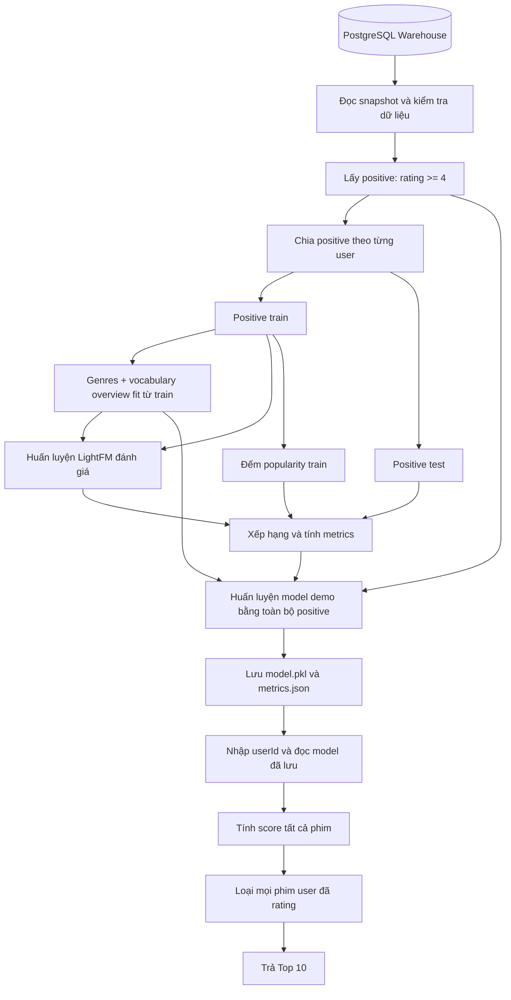

# Giải thích từng bước: từ PostgreSQL đến Top 10 phim

Tài liệu này diễn giải đúng phiên bản `recommend.py` hiện tại và artifact đã chạy trên dữ liệu của dự án. Các ví dụ có ghi “minh họa” chỉ dùng giải thích thuật toán; số liệu ghi “thực tế” được lấy từ `ml_artifacts/metrics.json`, `model.pkl` và `verification.json`.

## 1. Sau khi lưu dữ liệu vào DB, chúng ta đang có gì?

PostgreSQL lúc này là Data Warehouse: nơi giữ dữ liệu đã được ETL làm sạch và tích hợp. Lưu vào DB chưa tạo ra mô hình gợi ý. Đó mới là bước chuẩn bị đầu vào cho ML.

Hai nhóm thông tin quan trọng nhất là:

| Nhóm | Bảng | Trả lời câu hỏi |
|---|---|---|
| Hành vi | `fact_rating` | User nào đã đánh giá phim nào, bao nhiêu điểm? |
| Nội dung phim | `dim_movie` | Phim đó tên gì, thuộc thể loại nào, có mô tả gì? |

Ví dụ **thực tế** đã kiểm tra từ dữ liệu user 15:

| user_id | movie_id | rating | title |
|---:|---:|---:|---|
| 15 | 1 | 2.5 | Toy Story |
| 15 | 44 | 1.0 | Mortal Kombat |
| 15 | 47 | 3.5 | Seven (a.k.a. Se7en) |

Từ bảng này, chương trình biết user 15 đã đánh giá ba phim trên. Khi demo, cả ba phim đều phải bị loại khỏi gợi ý, dù rating cao hay thấp.

Không thể nói “đã đánh giá” đồng nghĩa chắc chắn “đã xem toàn bộ phim”. Dữ liệu dự án trực tiếp quan sát sự kiện rating.

## 2. Các trường trong Warehouse có nghĩa gì?

### 2.1. Bảng fact_rating: mỗi dòng là một cặp user–phim được đánh giá

| Trường | Kiểu PostgreSQL | Ý nghĩa | Dùng thế nào trong ML hiện tại? |
|---|---|---|---|
| `user_id` | integer | Mã người dùng MovieLens | Xác định người nhận gợi ý và nhóm tương tác để chia train/test |
| `movie_id` | integer | Mã phim MovieLens | Nối sang phim, tạo tương tác và lọc phim đã rating |
| `rating` | double precision | Điểm từ 0.5 đến 5.0 | Rating ≥ 4 tạo positive; mọi rating được giữ để lọc lịch sử demo |
| `time_id` | bigint | Khóa tới chiều thời gian, grain theo giờ | Kiểm tra tham chiếu; không dùng làm feature hay chia theo thời gian |
| `rating_timestamp` | timestamp without time zone | Thời điểm rating chi tiết | Có trong DB nhưng không được query vào model hiện tại |

Khóa chính ghép `(user_id, movie_id)` bảo đảm một cặp chỉ có một dòng trong Warehouse. ETL hiện tại giữ rating mới nhất nếu nguồn có cặp trùng.

### 2.2. Bảng dim_movie: mỗi dòng là một phim

| Trường | Kiểu PostgreSQL | Ý nghĩa | Dùng trong model hiện tại? |
|---|---|---|---|
| `movie_id` | integer | ID phim của MovieLens | Có: định danh phim và nối rating |
| `title` | text | Tên phim đã xử lý ở ETL | Chỉ hiển thị, không đưa tên phim vào features |
| `genres` | text | Các thể loại MovieLens, phân cách bằng `\|` | Có: tách thành các feature thể loại |
| `release_year` | integer | Năm phát hành được ETL trích từ title MovieLens | Không |
| `release_decade` | integer | Thập niên tương ứng, ví dụ 1990 | Không |
| `tmdb_id` | integer | Mã phim ở TMDB | Khóa tích hợp nguồn; không phải feature số cho model |
| `popularity` | double precision | Chỉ số độ phổ biến do TMDB cung cấp | Không |
| `vote_average` | double precision | Điểm đánh giá trung bình bên TMDB | Không |
| `vote_count` | integer | Số lượt đánh giá bên TMDB | Không |
| `overview` | text | Mô tả nội dung TMDB hoặc chuỗi thay thế khi thiếu | Có, nhưng chỉ dùng mô tả thực và chuyển thành token |
| `has_tmdb_metadata` | boolean | Cờ ETL ghi nhận phim ghép được metadata TMDB | Dùng quyết định overview nào được xử lý; không thêm trực tiếp thành feature |

`movie_id` và `tmdb_id` là hai hệ mã khác nhau. Trong dự án, `links.csv` cung cấp ánh xạ giữa chúng; không JOIN trực tiếp hai ID như thể chúng cùng hệ.

Có `tmdb_id` chưa đủ để kết luận đã lấy được metadata. Cần kiểm tra cờ, dữ liệu thực và đối chiếu nguồn. Lần chạy hiện tại xác minh được 300 phim có metadata thực trên 9.742 phim.

### 2.3. Các bảng còn lại

| Bảng | Các trường | Vai trò trong luồng hiện tại |
|---|---|---|
| `dim_user` | `user_id` | Danh mục user; được JOIN để xác nhận rating có user hợp lệ |
| `dim_genre` | `genre_id`, `genre_name` | Danh mục thể loại; chương trình kiểm tra bảng tồn tại/có dữ liệu, nhưng features đọc từ `dim_movie.genres` |
| `bridge_movie_genre` | `movie_id`, `genre_id` | Liên kết phim–thể loại nhiều–nhiều; không JOIN bảng này khi trích ratings cho ML |
| `dim_time` | `time_id`, `hour_timestamp`, `hour`, `day`, `month`, `quarter`, `year`, `day_of_week`, `day_name` | Chiều thời gian phục vụ Warehouse; ML chỉ kiểm tra tham chiếu qua `time_id` |

Trong `dim_time`, `hour_timestamp` là mốc đầu giờ; `hour/day/month/quarter/year` là giờ/ngày/tháng/quý/năm; `day_of_week` là thứ trong tuần theo Pandas (thứ Hai = 0), `day_name` là tên thứ. Những trường này chưa được dùng để học xu hướng thời gian.

Không JOIN bridge vào bảng rating trong truy vấn ML giúp tránh nhân một rating thành nhiều dòng khi phim thuộc nhiều thể loại.

`tags.csv` có trong raw nhưng tags/keywords chưa được tích hợp thành trường trong schema dùng cho ML. Code không đọc trực tiếp tags raw để bổ sung lúc train.

## 3. Ba luồng cần phân biệt



| Lệnh | Đọc PostgreSQL? | Học lại model? | Làm việc chính |
|---|---|---|---|
| `--train` | Có | Có | Đọc DB, chia tập, học model đánh giá, tính metrics, refit model demo, lưu artifact |
| `--evaluate` | Không | Không | Đọc model và snapshot đã lưu, tính lại metrics trên split cũ |
| `--user-id 15` | Không | Không | Đọc model demo và lịch sử đã lưu, trả danh sách cho user 15 |

Vì vậy, PostgreSQL tắt sẽ làm train lỗi, nhưng evaluate và demo vẫn có thể chạy từ artifact cũ. Kết quả demo phản ánh snapshot lúc train; rating mới trong DB chưa tự xuất hiện trong artifact.

## 4. Luồng huấn luyện, chia nhỏ từng bước

### Bước 1 — Nhận lệnh train

```bash
uv run --active --no-project python recommend.py --train
```

`main()` đọc tham số và gọi `train_models(args)`. Mặc định: seed 42, 30 epochs, 32 chiều vector ẩn và 1 thread.

uv chọn/chạy môi trường Python. `recommend.py` thực hiện công việc ML. PostgreSQL lưu dữ liệu. Đây là ba vai trò khác nhau.

### Bước 2 — Lấy cấu hình kết nối

`read_warehouse()` đọc biến `DW_URL`, đồng thời nạp `.env` ở thư mục dự án. Nếu biến đã có trong môi trường, giá trị đó được ưu tiên.

Chuỗi kết nối chứa driver, host, port, database và tài khoản. Không hardcode mật khẩu trong script. Từ máy host, cổng PostgreSQL được cấu hình là 5434; cổng trong container là 5432.

### Bước 3 — Mở một snapshot chỉ đọc

Chương trình dùng transaction `REPEATABLE READ` và `SET TRANSACTION READ ONLY`.

- Snapshot giúp các truy vấn trong cùng transaction nhìn dữ liệu nhất quán.
- Chỉ đọc giúp thao tác ML không ghi hoặc sửa dữ liệu Warehouse.

ETL có trách nhiệm ghi DB; script Recommendation chỉ sử dụng đầu ra đã được nạp.

### Bước 4 — Kiểm tra điều kiện trước khi tải

Chương trình đọc `information_schema.columns`, xác nhận các cột bắt buộc, đếm 6 bảng và dừng nếu có bảng trống hoặc thiếu cột. Kiểu cột được lưu lại trong báo cáo nguồn.

Tiếp theo, code ước lượng dữ liệu tải vào RAM từ số rating và số phim. Nếu vượt ngân sách `ML_MEMORY_BUDGET_MB` (mặc định 1.024 MiB), chương trình dừng để xem lại tài nguyên; không tự lấy mẫu. Đây là ước lượng, không phải cơ chế đo/giới hạn peak RAM tuyệt đối.

Chương trình kiểm tra rating có tham chiếu hợp lệ tới user, phim và thời gian. Kiểm định PK/FK, bridge và miền giá trị còn được pipeline ETL kiểm tra trước đó.

### Bước 5 — Lấy hai bảng dữ liệu vào Python

Truy vấn ratings thực tế:

```sql
SELECT f.user_id, f.movie_id, f.rating
FROM fact_rating f
JOIN dim_movie m ON f.movie_id = m.movie_id
JOIN dim_user u ON f.user_id = u.user_id
ORDER BY f.user_id, f.movie_id;
```

Truy vấn catalog thực tế:

```sql
SELECT movie_id, title, genres, overview, has_tmdb_metadata
FROM dim_movie
ORDER BY movie_id;
```

Kết quả trở thành hai Pandas DataFrame:

| Biến | Dữ liệu thực tế | Mục đích |
|---|---|---|
| `ratings` | 100.836 dòng | Lọc positive, chia tập, giữ lịch sử đã rating |
| `movies` | 9.742 dòng | Toàn bộ catalog để tạo features, chấm điểm và hiển thị |

Có 9.724 phim xuất hiện trong ratings, nhưng catalog có 9.742 phim. Danh sách ứng viên hiện tại dùng toàn bộ catalog, gồm cả phim chưa có rating.

Sau truy vấn, code kiểm tra JOIN không làm mất/nhân dòng, không trùng cặp rating, không null ở khóa/rating, rating trong [0.5, 5] và khóa phim không trùng.

### Bước 6 — Ghi thông tin truy xuất nguồn

Code lưu số bảng, số user/phim, số phim có TMDB, schema và `snapshot_sha256`.

`SHA-256` là hàm băm tạo dấu vân tay cho hai DataFrame đã trích xuất; nó phục vụ đối chiếu snapshot, không phải thuật toán gợi ý và không phải kiểm chứng nguồn gốc API. Metadata và ratings thay đổi có thể làm hash thay đổi.

### Bước 7 — Chọn các tương tác tích cực

```python
positive = ratings[ratings.rating >= 4].copy()
```

Thực tế có **48.580 positive**.

| Rating | Đưa vào positive? | Có giữ để lọc phim đã rating khi demo? |
|---:|---|---|
| 5.0 | Có | Có |
| 4.0 | Có | Có |
| 3.5 | Không | Có |
| 1.0 | Không | Có |
| Chưa có rating | Không | Không có bằng chứng đã rating để lọc |

Đây là chuyển dữ liệu điểm số tường minh thành tín hiệu positive phục vụ học xếp hạng. Không dự đoán rating 1–5. Rating 4 và 5 đều tạo giá trị interaction=1; code không đặt rating 5 nặng hơn rating 4.

### Bước 8 — Chia train/test riêng cho từng user

Hàm: `split_positives()`.

Với một user có `n` positive:

```text
n >= 2: lấy ngẫu nhiên max(1, floor(0.2 × n)) positive làm test
         phần còn lại làm train
n = 1:  giữ positive duy nhất ở train, không đánh giá user này
n = 0:  không có positive để học, dùng fallback khi demo
```

Vì `n >= 2`, công thức giữ lại ít nhất 1 positive train cho mọi user có test. Seed 42 giúp tái lập cách chọn. Test chỉ lấy từ positive, không lấy rating thấp làm nhãn test.

**Thực tế:**

| Nhóm | Số lượng |
|---|---:|
| User có rating | 610 |
| User có ít nhất 1 positive, xuất hiện trong mapping LightFM | 609 |
| User có ít nhất 2 positive, được đánh giá | 608 |
| Positive train | 39.100 |
| Positive test | 9.480 |

User 214 có 1 positive, giữ ở train. User 442 có 20 ratings nhưng không có rating ≥4, nên không có vector user đã học và dùng baseline khi demo.

Code kiểm tra giao cặp train/test bằng 0 và user test đều có lịch sử train. Chia theo user ở đây là **giữ lại tương tác của từng user**, không phải tách user thành hai nhóm hoàn toàn khác nhau.

### Bước 9 — Tạo đặc trưng thể loại

Hàm: `make_features()`.

Chuỗi `Adventure|Animation|Children|Comedy|Fantasy` được tách thành các feature có tên:

```text
genre:Adventure
genre:Animation
genre:Children
genre:Comedy
genre:Fantasy
```

Đặc trưng thể loại lấy từ `dim_movie.genres` của MovieLens. Giá trị `(no genres listed)` được bỏ qua. Các phim cùng thể loại dùng chung feature tương ứng.

### Bước 10 — Chọn overview TMDB được phép xử lý

Code chỉ giữ mô tả có `has_tmdb_metadata=True`, bỏ chuỗi thay thế `No overview available` và bỏ văn bản rỗng khi chọn tập fit.

Trong 300 phim có metadata thực, **235 phim có positive train và overview hợp lệ** được dùng để học vocabulary ở lần chạy hiện tại. Sau đó, vocabulary này được dùng để biến đổi overview của toàn catalog.

Phim chỉ xuất hiện trong test không được dùng riêng để mở rộng vocabulary. Metadata catalog có sẵn vẫn có thể được transform; điều bị giữ kín là nhãn tương tác test.

### Bước 11 — Chuyển văn bản thành feature bằng CountVectorizer

Cấu hình thực tế:

```python
CountVectorizer(
    stop_words="english",
    min_df=2,
    max_features=300,
    binary=True,
)
```

| Tham số | Giải thích |
|---|---|
| `stop_words="english"` | Bỏ các từ tiếng Anh phổ biến trong danh sách stop words |
| `min_df=2` | Một token phải xuất hiện trong ít nhất 2 overview của tập fit |
| `max_features=300` | Giữ tối đa 300 token theo tần suất corpus sau lọc |
| `binary=True` | Trong từng overview, token xuất hiện thì là 1; lặp nhiều lần vẫn là 1 |

Ví dụ **minh họa**, nếu vocabulary có `space` và `family`:

```text
Overview: "A family travels through space"
Features: overview:family, overview:space
```

Đây là biểu diễn túi từ nhị phân đơn giản. Nó không hiểu đầy đủ ngữ nghĩa hay thứ tự câu, không dùng TF-IDF hoặc mô hình ngôn ngữ.

### Bước 12 — Thêm identity và ánh xạ ID

`Dataset()` của LightFM giữ identity features mặc định. Mỗi phim vừa có đặc trưng riêng theo ID, vừa có genre/token dùng chung.

```text
Biểu diễn phim = identity riêng + features thể loại + features overview
```

`user_map` và `item_map` đổi ID ngoài thành chỉ số liên tiếp từ 0 để dùng trong ma trận. ID chỉ là định danh, không phải số có ý nghĩa độ lớn.

Ví dụ **thực tế** của mapping đã lưu:

| ID ngoài | Chỉ số nội bộ |
|---|---:|
| user_id=15 | 14 |
| movie_id=1 | 0 |
| movie_id=480 | 418 |
| movie_id=7153 | 4.800 |

Khi trả kết quả, chương trình dùng ID phim và title thật để hiển thị, không đưa chỉ số nội bộ làm movieId.

### Bước 13 — Tạo hai ma trận thưa

| Ma trận | Kích thước thực tế | Ý nghĩa |
|---|---|---|
| Tương tác train | 609 × 9.742 | Hàng là user có positive, cột là phim, entry=1 nếu là positive train |
| Item features | 9.742 × 10.061 | Hàng là phim, cột là identity/genre/token |

10.061 cột feature gồm **9.742 identity + 19 genre + 300 token**. Ma trận item features có 34.189 entry khác 0.

`build_item_features()` mặc định chuẩn hóa mỗi hàng để tổng trọng số bằng 1. Vì vậy, danh sách feature ban đầu là có/không nhưng giá trị cuối trong ma trận feature không nhất thiết là 1; nếu phim có `s` feature hiện diện thì mỗi feature có trọng số `1/s` trong cấu hình hiện tại.

Hàm `interactions()` tự dựng COO rồi đổi sang CSR bằng SciPy. Ma trận thưa chỉ lưu các entry khác 0, tiết kiệm RAM hơn một bảng dense lớn.

Entry không có positive trong ma trận tương tác thể hiện chưa có positive train. Nó không phải nhãn khẳng định user ghét phim.

### Bước 14 — Huấn luyện model đánh giá LightFM + WARP

```python
evaluation_model = LightFM(
    loss="warp",
    no_components=32,
    random_state=42,
)
evaluation_model.fit(
    interactions_train,
    item_features=item_features,
    epochs=30,
    num_threads=1,
)
```

`evaluation_model` chỉ học từ **39.100 positive train**. Test không được truyền vào `fit()`. Phần giải thích thuật toán nằm ở mục 5.

### Bước 15 — Tạo baseline Most Popular

Hàm: `popularity()`.

```text
popularity_train(phim) = số user khác nhau có positive train cho phim đó
```

Baseline xếp theo số đếm này, không dùng `dim_movie.popularity` từ TMDB. Đây là hai khái niệm phổ biến khác nhau.

Baseline không học sở thích riêng. Danh sách cuối của hai user vẫn có thể khác nhau vì các phim đã biết bị loại khác nhau. Khi số đếm bằng nhau, code ưu tiên `movie_id` nhỏ hơn.

### Bước 16 — Đánh giá model và baseline

Hàm: `evaluate()`. Với từng user có test:

1. Lấy tập phim positive test làm `relevant` — đáp án cần tìm lại.
2. Tạo tập loại trừ gồm positive train và các rating <4 đã quan sát.
3. Giữ positive test trong danh sách ứng viên, vì đó là những phim đang giả lập chưa được biết trong quá trình đánh giá.
4. Tính score LightFM cho toàn bộ catalog.
5. Lấy Top 10 theo score, áp dụng tập loại trừ.
6. Lấy Top 10 baseline theo popularity train, áp dụng đúng cùng tập loại trừ.
7. So từng danh sách với `relevant`, tính ba metric.
8. Lấy trung bình theo 608 user, mỗi user có trọng số bằng nhau.

Không loại toàn bộ ratings ở bước đánh giá: làm vậy sẽ loại luôn phim test, khiến chúng không thể được tìm lại. Demo thật ở bước sau mới loại toàn bộ ratings.

Quy trình này là random holdout positive theo user, giữ rating thấp như lịch sử đã biết. Nó không mô phỏng nghiêm ngặt thứ tự thời gian hoặc dự đoán lần xem kế tiếp.

### Bước 17 — Huấn luyện model demo trên toàn bộ positive

Sau khi tính metrics, code tạo **một model LightFM mới** tên `model` và học lại từ toàn bộ **48.580 positive**.

Mục đích là dùng đủ lịch sử hiện có khi gợi ý. Đó vẫn là cùng thuật toán và cùng tham số; khác tập dữ liệu dùng để fit. Feature matrix/vocabulary được giữ như lúc đánh giá để cách triển khai đơn giản và nhất quán.

| Model trong artifact | Học từ | Dùng để |
|---|---|---|
| `evaluation_model` | Positive train | Tính metric test |
| `model` | Toàn bộ positive | Demo gợi ý theo userId |

Model demo đã học cả các positive từng được giữ lại làm test, nên **không dùng nó báo metric test**. Các metric đã công bố lấy từ `evaluation_model`.

Popularity dùng cho fallback demo cũng được đếm lại từ toàn bộ positive; baseline đánh giá vẫn chỉ đếm train.

### Bước 18 — Lưu kết quả để lần sau không phải train lại

| File | Nội dung |
|---|---|
| `ml_artifacts/model.pkl` | Gói model, dữ liệu snapshot, mappings, features, split và báo cáo |
| `ml_artifacts/metrics.json` | Nguồn dữ liệu, tham số, thống kê split và metrics |
| `ml_artifacts/training.log` | Log của lần train được chạy có chuyển hướng output |
| `ml_artifacts/verification.json` | Bằng chứng kiểm tra thực tế đã thực hiện |

`model.pkl` là một gói nhiều thành phần, không chỉ chứa trọng số. Chỉ load pickle do dự án tự tạo và tin cậy.

## 5. Giải thích các thuật toán và kỹ thuật

### 5.1. LightFM: học cách tính điểm phù hợp

LightFM học các vector số cho user và feature của phim. Trong cấu hình hiện tại, mỗi vector có **32 chiều**. Các chiều là yếu tố ẩn do model học, không được gán cứng thành 32 thể loại.

Vector phim được tổng hợp từ vector identity và vector metadata, theo trọng số trong feature matrix. User hiện chỉ có identity; không có feature tuổi, giới tính hay nghề nghiệp.

Điểm của một user–phim có dạng:

```text
score(user, phim) = tích vô hướng(vector user, vector phim)
                   + bias user + bias phim
```

Tích vô hướng là tổng các tích ở cùng vị trí của hai vector. Bias là phần bù học được; bias phim có thể thể hiện xu hướng một phim nhận điểm cao nói chung trong mô hình. Bias user là hằng số khi xếp các phim cho cùng user nên không làm đổi thứ tự riêng của user đó.

Phần identity học các mẫu tương tác cộng tác; metadata dùng chung giúp các phim chia sẻ thông tin về nội dung. Có thể gọi đây là hybrid trong **một mô hình**, không phải ghép hai danh sách từ hai model riêng.

LightFM không tìm một user hàng xóm bằng KNN và không có luật thủ công “thích Action thì luôn đề xuất Action”. Mức độ phù hợp được học qua dữ liệu và hàm mất mát. Xem [tài liệu LightFM](https://making.lyst.com/lightfm/docs/lightfm.html).

### 5.2. WARP: hướng dẫn LightFM học thứ hạng

WARP viết tắt của **Weighted Approximate-Rank Pairwise**. Đây là loss dùng để huấn luyện LightFM, không phải model thứ hai.

Một vòng cập nhật có thể hiểu như sau:

1. Chọn cặp `(user u, phim positive i)` trong train.
2. Lấy mẫu một phim ứng viên `j` không phải positive đã biết của user trong train.
3. Tính score cho `i` và `j`.
4. Nếu thứ hạng vi phạm khoảng cách mong muốn, cập nhật vector để `i` có xu hướng xếp cao hơn `j`.
5. Nếu chưa tìm được vi phạm, tiếp tục lấy mẫu trong giới hạn của thư viện.
6. Độ nặng của cập nhật liên quan tới ước lượng thứ hạng từ quá trình lấy mẫu, nhằm ưu tiên chất lượng đầu danh sách.

Ví dụ **minh họa**: user thích phim A nhưng model chấm A thấp hơn ứng viên B. Loss tạo tín hiệu điều chỉnh để A có điểm cao hơn trong các lần sau.

WARP dùng “negative sample” theo nghĩa ứng viên so sánh chưa có positive train; không phải dữ liệu xác nhận user ghét phim. Code không truyền rating thấp thành -1. Trong holdout, phim test có thể nằm trong tập ứng viên lấy mẫu vì model không được biết nhãn test; đây cũng là hạn chế thường gặp của học implicit feedback.

Không cần dự đoán chính xác rating nếu mục tiêu là tìm các phim phù hợp ở đầu Top 10. Xem [giải thích WARP của LightFM](https://making.lyst.com/lightfm/docs/examples/warp_loss.html).

### 5.3. CountVectorizer: biến mô tả thành số đầu vào

Đây là bước xử lý văn bản, không phải model gợi ý thứ hai. Nó tách token, lọc token và tạo ma trận có/không token theo cấu hình ở bước 11. Các feature kết quả được LightFM học cùng identity và genres.

Trong dự án, mô tả thường bằng tiếng Anh nên dùng stop words tiếng Anh. Chưa có stemming, hiểu đồng nghĩa hoặc hiểu ngữ cảnh. Xem [tài liệu CountVectorizer 1.4](https://scikit-learn.org/1.4/modules/generated/sklearn.feature_extraction.text.CountVectorizer.html).

### 5.4. Most Popular: mốc so sánh đơn giản

Ví dụ **minh họa** trong train:

| Phim | Số user positive |
|---|---:|
| A | 200 |
| B | 150 |
| C | 50 |

Baseline ưu tiên A → B → C. Nếu user đã rating A, danh sách của họ bỏ A. Không tính rating trung bình, không dùng vote_count hay popularity TMDB.

Nếu LightFM không hơn baseline, việc thêm cá nhân hóa chưa chứng minh được lợi ích theo phép đo hiện tại. Nếu hơn, ta có bằng chứng thực nghiệm trên split đã dùng; chưa thể kết luận nó luôn tốt hơn.

### 5.5. Bảng tổng hợp vai trò

| Thành phần | Đầu vào | Đầu ra | Học gì? |
|---|---|---|---|
| Quy tắc rating ≥4 | Rating | Positive | Không học, là quy ước nghiệp vụ |
| Chia holdout theo user | Positive + seed | Train/test | Không học, tạo điều kiện kiểm tra |
| CountVectorizer | Overview | Features token | Fit vocabulary, không học sở thích user |
| LightFM | Interactions + features | Vector và score | Học sở thích và biểu diễn phim |
| WARP | Score và positive train | Tín hiệu tối ưu | Định hướng cập nhật để cải thiện thứ hạng |
| Most Popular | Positive train | Số đếm theo phim | Thống kê độ phổ biến làm baseline |
| Lọc và sort | Score + lịch sử | Top K | Quy tắc tạo đầu ra, không học |
| Metrics | Top K + positive test | Ba số đánh giá | Đo chất lượng, không huấn luyện model |

## 6. Metrics: tính như thế nào?

Gọi `T(u)` là tập positive test và `R10(u)` là Top 10 sau khi lọc của user u. `hit` là phim nằm trong cả hai tập.

### 6.1. Precision@10

```text
Precision@10(user) = số hit / 10
```

Ví dụ **minh họa**: trong 10 gợi ý có 2 phim thuộc test thì Precision@10 = 0,2.

### 6.2. Recall@10

```text
Recall@10(user) = số hit / số positive test của user
```

Ví dụ **minh họa**: user có 5 phim test, Top 10 tìm lại được 2 thì Recall@10 = 0,4.

### 6.3. NDCG@10

Đặt `rel(r)=1` nếu phim ở hạng r thuộc positive test, ngược lại bằng 0:

```text
DCG@10 = tổng rel(r) / log2(r + 1), r từ 1 đến 10
IDCG@10 = DCG của danh sách lý tưởng, đưa hit lên đầu,
          có min(10, số positive test) vị trí relevant
NDCG@10 = DCG@10 / IDCG@10
```

Hit ở hạng 1 đóng góp nhiều hơn hit ở hạng 10. Chuẩn hóa bằng IDCG đưa kết quả về [0,1] cho mỗi user.

Các metric được tính từng user rồi lấy trung bình. Precision@10 trung bình 0,1893 tương ứng khoảng 1,893 hit trong 10 đề xuất trên mỗi user được đánh giá; **không phải xác suất user thích từng phim là 18,93%**.

Phim không có trong test có thể vẫn được user thích nhưng chưa được quan sát. Metrics chỉ đo khả năng tìm lại positive test đã có nhãn.

### 6.4. Kết quả thực tế

| Model | Precision@10 | Recall@10 | NDCG@10 |
|---|---:|---:|---:|
| Most Popular | 0,127961 | 0,108645 | 0,171856 |
| LightFM + WARP | 0,189309 | 0,170421 | 0,247525 |

LightFM tốt hơn baseline trên split hiện tại ở cả ba metric. Vì chưa chạy ablation bỏ overview/genres, chưa tách riêng được mức đóng góp của từng nhóm feature. Không tune tham số bằng test.

## 7. Luồng demo khi nhập userId, từng bước nhỏ

Lệnh:

```bash
uv run --active --no-project python recommend.py --user-id 15 --top-k 10
```

### Bước 1 — Đọc artifact

`main()` load `ml_artifacts/model.pkl`. Không truy vấn PostgreSQL và không huấn luyện lại.

### Bước 2 — Lấy lịch sử user

Hàm `recommend()` lọc snapshot `ratings` theo `user_id=15`. User 15 thực tế có **135 phim đã rating**, trong đó 56 positive. Trong split đánh giá, 56 positive này được chia 45 train và 11 test.

### Bước 3 — Kiểm tra có vector user hay không

Nếu user có trong `user_map`, dùng model demo LightFM. Nếu user không tồn tại hoặc chưa có positive, thông báo lý do và dùng Most Popular của toàn bộ positive đã nạp. Ví dụ user 442 thuộc trường hợp thứ hai.

### Bước 4 — Tính score cho toàn bộ catalog

Với user hợp lệ, `model.predict()` tạo 9.742 score, mỗi score tương ứng một phim. Vector user cố định, vector phim thay đổi theo từng ứng viên.

### Bước 5 — Loại tất cả phim đã rating

`ranked_items()` bỏ 135 phim trong lịch sử của user 15, còn **9.607 ứng viên**. Bao gồm cả việc loại phim rating thấp và positive từng là test trước khi refit.

### Bước 6 — Sắp xếp và lấy 10 phim

Ưu tiên score giảm dần. Nếu score bằng nhau, ưu tiên movie_id tăng dần để thứ tự xác định. `top_k=10` lấy 10 vị trí đầu sau khi loại lịch sử.

### Bước 7 — Gắn title và in ra terminal

Kết quả thực tế đã lưu cho user 15:

| Hạng | movie_id | Phim | Score |
|---:|---:|---|---:|
| 1 | 7153 | Lord of the Rings: The Return of the King, The | 1,918277 |
| 2 | 480 | Jurassic Park | 1,902063 |
| 3 | 7361 | Eternal Sunshine of the Spotless Mind | 1,767160 |
| 4 | 44191 | V for Vendetta | 1,645883 |
| 5 | 593 | Silence of the Lambs, The | 1,538720 |
| 6 | 1704 | Good Will Hunting | 1,538101 |
| 7 | 1682 | Truman Show, The | 1,528276 |
| 8 | 3793 | X-Men | 1,507964 |
| 9 | 4878 | Donnie Darko | 1,506416 |
| 10 | 110 | Braveheart | 1,369311 |

Score 1,918277 chỉ lớn hơn score của các ứng viên xếp sau trong lần dự đoán này. Không đổi thành 191,8%, xác suất hoặc điểm rating trên thang 5. Fallback baseline in số đếm positive, không phải score LightFM.

## 8. Các biến và tham số trong code

| Tên | Ý nghĩa |
|---|---|
| `positive` | Tất cả rating ≥4 |
| `train`, `test` | Hai DataFrame positive sau holdout |
| `features` | Ma trận thưa item features đã chuẩn hóa |
| `user_map`, `item_map` | Ánh xạ ID thật sang chỉ số nội bộ |
| `movie_ids` | Danh sách ID phim theo thứ tự catalog |
| `item_indices` | Chỉ số 0..n_items-1 dùng khi predict |
| `train_seen` | Phim positive train theo user, dùng mask đánh giá |
| `low_seen` | Phim rating <4 theo user, dùng mask đánh giá |
| `history` | Mọi rating của user trong snapshot, dùng mask demo |
| `excluded` | Tập phim cần loại trước khi lấy Top K |
| `relevant` | Positive test của một user, dùng làm đáp án đánh giá |
| `scores` | Điểm xếp hạng theo từng phim |
| `bundle` | Gói dữ liệu/model/features/mapping được pickle lưu lại |
| `source` | Thông tin schema, counts và fingerprint của snapshot |
| `seed` / `random_state` | Điều khiển ngẫu nhiên để tái lập split và khởi tạo/học model |
| `no_components=32` | Số chiều vector ẩn; không phải số phim gợi ý |
| `epochs=30` | Số lượt huấn luyện qua tập tương tác; không phải số user |
| `num_threads=1` | Một luồng tính toán để thuận tiện tái lập |
| `top_k=10` | Số phim tối đa yêu cầu trong đầu ra |

Trong `metrics.json`, `train_test_overlap` là số cặp giao nhau, `test_users_without_train` là số user test thiếu train, `overview_vocabulary` là số token được giữ. Với lần chạy hiện tại, hai chỉ số kiểm tra đầu bằng 0 và vocabulary có 300 token.

## 9. Mở code theo thứ tự nào để dễ đọc?

| Thứ tự | Hàm trong recommend.py | Câu hỏi cần hiểu |
|---:|---|---|
| 1 | `main()` | Lệnh nào gọi luồng nào? |
| 2 | `train_models()` | Trình tự điều phối khi train ra sao? |
| 3 | `read_warehouse()` | Dữ liệu lấy từ đâu, được kiểm tra thế nào? |
| 4 | `split_positives()` | Positive nào được học và positive nào được giấu? |
| 5 | `make_features()` | Phim được mô tả bằng những gì? |
| 6 | `interactions()` | Các cặp positive đổi thành ma trận thế nào? |
| 7 | `popularity()` | Baseline đếm gì? |
| 8 | `evaluate()` / `ranking_metrics()` | Kiểm tra chất lượng bằng cách nào? |
| 9 | `recommend()` / `ranked_items()` | Từ userId đến danh sách cuối ra sao? |

## 10. Chạy lại bằng uv và xử lý các tình huống thường gặp

Trên workspace đã có môi trường/dependencies:

```bash
source .venv/bin/activate

# Cần cho train; giữ nguyên dữ liệu trong volume đã nạp.
docker compose up -d --wait postgres-dw

# Train bao gồm đánh giá và refit model demo.
uv run --active --no-project python recommend.py --train

# Hai lệnh sau dùng artifact đã lưu.
uv run --active --no-project python recommend.py --evaluate
uv run --active --no-project python recommend.py --user-id 15 --top-k 10

# Ví dụ fallback vì user chưa có positive.
uv run --active --no-project python recommend.py --user-id 442 --top-k 10
```

`--active` dùng môi trường đang active; `--no-project` không dùng cơ chế project/sync của uv cho lệnh này. Các dependencies đã được cài trong `.venv`. Riêng LightFM 1.17 được cài bằng pip legacy do lỗi đóng gói với build backend mặc định; uv vẫn được dùng để chuẩn bị/chạy Python.

| Tình huống | Nguyên nhân/cách xử lý |
|---|---|
| Train báo lỗi Warehouse | Kiểm tra container bằng `docker compose ps`, khởi động lệnh ở trên, kiểm tra DW_URL và schema |
| Evaluate chạy được dù train lỗi DB | Evaluate dùng artifact từ lần train trước; không chứng minh DB đang kết nối được |
| Không thấy model.pkl | Cần train thành công trước khi evaluate/demo |
| Terminal có KeyboardInterrupt | Tiến trình đã bị ngắt, thường do Ctrl+C; chạy lại và chờ kết thúc |
| DB có rating mới nhưng demo chưa đổi | Demo dùng snapshot cũ; train lại để đọc snapshot mới |
| Muốn đổi user | Thay số ở `--user-id`, không cần train lại cho từng user |

## 11. Những giới hạn cần nói đúng khi bảo vệ

- Hệ thống hiện tại dùng Raw Storage local; chưa chứng minh MinIO chạy thành công trong môi trường này.
- Chỉ 300/9.742 phim có TMDB metadata thực. Không thể nói mọi phim đều có nội dung TMDB đầy đủ.
- Phần recommender không đọc trực tiếp CSV; CSV/JSON chỉ là đầu vào ETL và nguồn kiểm chứng dữ liệu.
- User mới hoặc không có positive dùng baseline; chưa có user features để cá nhân hóa cold-start.
- Phim không có positive train có thể sử dụng metadata dùng chung, nhưng identity của nó chưa có tín hiệu positive riêng. Phim mới ngoài catalog cần cập nhật mapping và retrain; CLI chưa tự nhận phim mới.
- Chia ngẫu nhiên positive theo user kiểm tra khả năng tìm lại sở thích bị giấu; không phải kiểm chứng dự đoán tương lai theo thời gian.
- Không chạy nhiều seed, ablation, A/B test hoặc đo hài lòng thực. Chỉ kết luận theo phép đánh giá đã thực hiện.
- Cả 610 user đã được kiểm tra đầu ra Top 10 không chứa phim từng rating; một user trong số đó dùng fallback vì không có positive.

Một cách diễn đạt khi thuyết trình:

> Sau khi ETL nạp dữ liệu vào PostgreSQL, nhóm đọc ratings và metadata bằng truy vấn chỉ đọc. Nhóm chọn rating từ 4 trở lên làm positive, giấu một phần positive của từng user để kiểm tra, rồi huấn luyện LightFM bằng WARP với đặc trưng thể loại và từ trong overview TMDB. Nhóm so sánh với baseline phổ biến bằng Precision, Recall và NDCG tại 10. Sau đánh giá, nhóm học lại trên toàn bộ positive để demo. Khi nhập userId, chương trình tính score các phim, bỏ toàn bộ phim user đã đánh giá và trả 10 phim đứng đầu.
