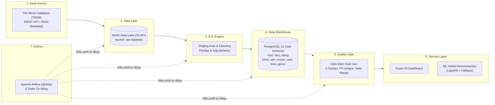

# SLIDE BÁO CÁO BẢO VỆ ĐỒ ÁN (25 TRANG)
## ĐỀ TÀI: XÂY DỰNG NỀN TẢNG DỮ LIỆU HIỆN ĐẠI (DATA LAKE, DATA WAREHOUSE, AIRFLOW, POWER BI VÀ HỆ THỐNG GỢI Ý PHIM HYBRID RECOMMENDATION)

---

### SLIDE 1: TRANG TIÊU ĐỀ & GIỚI THIỆU ĐỒ ÁN
* **Tên đề tài**: Xây dựng Nền tảng Dữ liệu Toàn diện: Từ Data Lake, Kho dữ liệu Star Schema, Điều phối Tự động Airflow đến Dashboard Power BI và Hệ thống Gợi ý Phim Thông minh.
* **Lĩnh vực**: Kỹ thuật Dữ liệu (Data Engineering) • Phân tích Dữ liệu (BI) • Trí tuệ Nhân tạo (Machine Learning).
* **Sinh viên thực hiện**: [Họ và tên sinh viên]
* **Mã số sinh viên**: [MSSV]
* **Giảng viên hướng dẫn**: [Họ và tên giảng viên]
* **Mục tiêu đề tài**:
  * Xây dựng pipeline tự động hóa thu thập và làm sạch dữ liệu điện ảnh chuẩn công nghiệp.
  * Thiết kế kho dữ liệu Data Warehouse theo mô hình Star Schema tối ưu hóa cho phân tích OLAP.
  * Trực quan hóa bức tranh toàn cảnh ngành điện ảnh trên Power BI.
  * Ứng dụng Machine Learning gợi ý phim cá nhân hóa cho người dùng.

> 🎤 **Lời thoại gợi ý (Speaker Notes)**:  
> *"Kính thưa quý thầy cô trong hội đồng, hôm nay em xin phép trình bày báo cáo đồ án về xây dựng nền tảng dữ liệu toàn diện từ thu thập, lưu trữ hồ dữ liệu, kho dữ liệu, điều phối tự động đến phân tích kinh doanh và gợi ý thông minh."*

---

### SLIDE 2: BỐI CẢNH & BÀI TOÁN THỰC TIỄN
* **Bối cảnh ngành điện ảnh & streaming**:
  * Lượng phim phát hành và số lượt tương tác của người xem tăng trưởng theo cấp số nhân.
  * Dữ liệu phân mảnh ở nhiều dạng: Cấu trúc (ratings người dùng), bán cấu trúc (JSON metadata từ API), phi cấu trúc (văn bản tóm tắt cốt truyện, hình ảnh poster).
* **Thách thức đặt ra**:
  * Làm thế nào lưu trữ khối lượng lớn dữ liệu thô an toàn, chi phí thấp?
  * Làm sao chuyển đổi dữ liệu thô thành mô hình chuẩn phục vụ báo cáo với độ trễ thấp?
  * Làm sao tự động hóa toàn bộ quy trình mà không cần can thiệp thủ công hàng ngày?
  * Làm sao để giúp người dùng khám phá đúng bộ phim yêu thích giữa hàng chục nghìn phim?
* **Giải pháp của đồ án**:
  * Xây dựng kiến trúc Modern Data Stack kết hợp Data Lake (MinIO), Data Warehouse (PostgreSQL), Orchestration (Airflow), BI (Power BI) và Machine Learning (LightFM).

> 🎤 **Speaker Notes**:  
> *"Thách thức lớn nhất trong các nền tảng streaming hiện nay là dữ liệu đến từ nhiều nguồn khác nhau. Nếu không có một kiến trúc chuẩn, doanh nghiệp vừa lãng phí chi phí lưu trữ, vừa không thể khai thác giá trị dữ liệu cho kinh doanh và trải nghiệm người dùng."*

---

### SLIDE 3: SƠ ĐỒ KIẾN TRÚC TỔNG THỂ HỆ THỐNG
* **Kiến trúc luồng dữ liệu 7 tầng tuần tự (Horizontal Architecture)**:



> 🎤 **Speaker Notes**:  
> *"Đây là sơ đồ kiến trúc tổng thể của hệ thống. Dữ liệu di chuyển theo chiều ngang từ trái sang phải qua 6 trạm chính: Nguồn TMDB -> Data Lake MinIO -> Động cơ ETL -> Data Warehouse PostgreSQL -> Cổng kiểm định chất lượng -> Tầng phục vụ gồm Power BI và Machine Learning. Toàn bộ chuỗi này được điều phối bởi Apache Airflow."*

---

### SLIDE 4: TỔNG QUAN HỆ SINH THÁI CÔNG NGHỆ (TECH STACK)
* **Bảng tổng hợp công nghệ sử dụng trong đồ án**:

| Thành phần | Công nghệ chính | Phiên bản | Vai trò cốt lõi |
| :--- | :--- | :---: | :--- |
| **Data Source** | TMDB REST API | v3 | Cung cấp siêu dữ liệu điện ảnh (overview, poster, rating toàn cầu) |
| **Data Lake** | MinIO Object Storage | Latest | Lưu trữ đối tượng tương thích chuẩn Amazon S3 API |
| **Orchestration**| Apache Airflow | 2.8.1 | Điều phối quy trình dữ liệu tự động theo đồ thị DAG |
| **ETL Engine** | Python, Pandas, SQLAlchemy| 3.11 / 2.1.4| Làm sạch, khử trùng, bóc tách cấu trúc và nạp kho |
| **Data Warehouse**| PostgreSQL | 15-alpine | Cơ sở dữ liệu quan hệ tổ chức mô hình hình sao (Star Schema OLAP) |
| **BI Tool** | Microsoft Power BI | 2024+ | Xây dựng Dashboard phân tích chỉ số kinh doanh qua DAX |
| **Machine Learning**| LightFM, Scikit-learn | 1.17 / 1.4.2| Gợi ý phim cá nhân hóa theo thuật toán Hybrid WARP Loss |
| **DevOps** | Docker & Docker Compose | v29+ | Ảo hóa và cô lập môi trường toàn bộ hệ thống |

> 🎤 **Speaker Notes**:  
> *"Tất cả công nghệ đều được tuyển chọn theo các tiêu chuẩn công nghiệp hiện đại, ưu tiên mã nguồn mở, độ ổn định cao và dễ dàng đóng gói triển khai trong môi trường Docker."*

---

### SLIDE 5: TẦNG 1 - NGUỒN DỮ LIỆU ĐIỆN ẢNH (DATA SOURCES & ENRICHMENT)
* **Tổng quan 2 Nguồn Dữ Liệu Kết Hợp**:

| Nguồn Dữ Liệu | Loại Dữ Liệu | Định dạng | Quy mô thực tế | Vai trò trong hệ thống |
| :--- | :--- | :---: | :---: | :--- |
| **MovieLens 100K** | Tương tác & Đánh giá người dùng | CSV (Có cấu trúc) | **100.836** ratings<br/>**9.742** phim<br/>**610** users | Cung cấp dữ liệu sự kiện (Fact) về hành vi đánh giá và danh mục phim gốc. |
| **The Movie Database (TMDB)** | Siêu dữ liệu mở rộng (Metadata) | JSON qua REST API (Bán cấu trúc) | **300+** phim chi tiết metadata | Làm giàu dữ liệu: Cốt truyện (`overview`), ảnh bìa (`poster`), vote cộng đồng quốc tế. |

* **Chi tiết cấu trúc các tệp dữ liệu thô**:
  * `movies.csv` (9.742 dòng): `movieId`, `title` (kèm năm phát hành), `genres` (phân cách bằng `|`).
  * `ratings.csv` (100.836 dòng): `userId`, `movieId`, `rating` (0.5 - 5.0 sao), `timestamp` (Unix epoch).
  * `links.csv` (9.742 dòng): **Cầu nối ánh xạ cốt lõi** `movieId` $\rightarrow$ `imdbId` và `tmdbId`.
  * `tags.csv` (3.683 dòng): Nhãn mô tả cảm xúc của người dùng gắn với phim.
  * `tmdb_movies_raw.json`: Siêu dữ liệu TMDB làm giàu (`overview`, `poster_path`, `vote_average`, `vote_count`).

* **Cơ chế liên kết làm giàu dữ liệu (Data Enrichment)**:
  * Ánh xạ tự động: `movies.movieId` $\rightarrow$ `links.movieId` $\rightarrow$ `links.tmdbId = TMDB.id`.
  * Phục vụ trọn vẹn 3 phân hệ: Fact/Dim cho **Data Warehouse**, Biểu đồ trực quan cho **Power BI**, và Vector hóa cốt truyện cho **Machine Learning**.

> 🎤 **Speaker Notes**:  
> *"Tại tầng nguồn dữ liệu, hệ thống tích hợp hai nguồn quan trọng: MovieLens cung cấp hơn 100 nghìn lượt đánh giá chuẩn học thuật từ 610 người dùng, và TMDB API cung cấp siêu dữ liệu cốt truyện, poster và điểm vote quốc tế. Cầu nối ánh xạ qua file links.csv giúp làm giàu toàn bộ dữ liệu phim trước khi nạp vào hồ dữ liệu MinIO."*

---

### SLIDE 6: TẦNG 2 - HỒ DỮ LIỆU THÔ MINIO (DATA LAKE LAYER)
* **Bản chất của MinIO Object Storage**:
  * Tương thích 100% với giao thức Amazon Web Services S3 (Simple Storage Service).
  * Viết bằng ngôn ngữ Go, hiệu năng I/O cực cao.
* **Cấu hình Bucket & Phân vùng trong dự án**:
  * Tên Bucket trung tâm: `raw-datalake`.
  * Thư mục phân vùng logic:
    * `/movielens/`: Chứa các bản snapshot thô CSV (`movies.csv`, `ratings.csv`, `links.csv`).
    * `/tmdb/`: Chứa các file phản hồi thô JSON (`tmdb_movies_raw.json`).
* **Hai cổng dịch vụ chính**:
  * Port `9000`: S3 API Endpoint cho các script Python truy cập nạp và rút dữ liệu.
  * Port `9001`: Web Console UI cho quản trị viên theo dõi và kiểm tra trực quan.

> 🎤 **Speaker Notes**:  
> *"Tại tầng hồ dữ liệu, MinIO đóng vai trò như một kho S3 on-premise. Dữ liệu được đưa vào bucket `raw-datalake` nguyên bản, không chỉnh sửa, giúp bảo vệ dữ liệu gốc vĩnh viễn."*

---

### SLIDE 7: VAI TRÒ CỦA DATA LAKE TRONG MODERN DATA STACK
* **Triết lý ELT (Extract - Load - Transform)**:
  * Không làm sạch dữ liệu trước khi lưu trữ thô.
  * Lưu trữ trước, khi nào cần phân tích thì mới trích xuất để chuyển đổi (Schema-on-Read).
* **3 Lợi ích sống còn của Data Lake**:
  1. **Khả năng tái xử lý (Re-processability)**: Khi thuật toán ETL thay đổi hoặc có lỗi logic, hệ thống luôn có thể chạy lại từ đầu bằng dữ liệu thô gốc mà không sợ mất thông tin.
  2. **Bảo mật và Kiểm toán (Audit Trail)**: Dữ liệu nguồn không thể bị ghi đè hay mất mát ngoài ý muốn.
  3. **Tách biệt lưu trữ và tính toán (Decoupled Storage & Compute)**: MinIO quản lý việc lưu trữ, tài nguyên tính toán ETL chạy độc lập.

> 🎤 **Speaker Notes**:  
> *"Điểm cốt lõi của Data Lake là tính linh hoạt: chúng ta lưu dữ liệu thô trước, sau này dù nghiệp vụ hay thuật toán có đổi mới, ta vẫn luôn có dữ liệu gốc để tái xử lý."*

---

### SLIDE 8: TẦNG 3 - ĐIỀU PHỐI TỰ ĐỘNG VỚI APACHE AIRFLOW
* **Khái niệm Data Pipeline Orchestration**:
  * Quản lý chuỗi công việc tự động hóa có điều kiện, thứ tự ưu tiên và xử lý lỗi.
* **Các thành phần chính của Apache Airflow trong dự án**:
  * **DAG (Directed Acyclic Graph)**: Đồ thị có hướng không chu trình biểu diễn chuỗi xử lý ETL.
  * **Scheduler**: Trình lập lịch quét chu kỳ (@daily) và khởi chạy task.
  * **Webserver**: Giao diện Web trực quan (Port 8080) giám sát sức khỏe pipeline, log từng task theo thời gian thực.
  * **Metadata Database**: Cơ sở dữ liệu PostgreSQL lưu vết trạng thái của từng Task Instance.
  * **LocalExecutor**: Cơ chế chạy tiến trình song song an toàn trong Docker.

> 🎤 **Speaker Notes**:  
> *"Thay vì dùng các script hay cronjob rời rạc dễ gặp lỗi, Apache Airflow cho phép chúng ta quản lý toàn bộ vòng đời pipeline theo đồ thị DAG, tự động cảnh báo và thử lại khi có sự cố mạng."*

---

### SLIDE 9: CHI TIẾT 6 TASKS TRONG DAG AIRFLOW
* **Tên DAG**: `movielens_data_warehouse_etl` (Lập lịch chạy hàng ngày `@daily`):

```text
[Task 1: ingest_raw_to_minio] ──────> Đẩy dữ liệu thô vào Bucket MinIO S3
               │
               ▼
[Task 2: extract_from_minio]  ──────> Trích xuất dữ liệu từ MinIO về Staging
               │
               ▼
[Task 3: clean_and_transform] ──────> Khử trùng lặp, tách genres, chuẩn hóa giờ
               │
               ▼
[Task 4: load_dimension_tables] ────> Nạp dữ liệu vào dim_user, dim_movie, dim_time...
               │
               ▼
[Task 5: load_fact_rating]    ──────> Nạp bảng sự kiện fact_rating kiểm tra khóa ngoại
               │
               ▼
[Task 6: validate_data_warehouse] ──> Kiểm định số dòng, không có orphan key, hoàn tất!
```

> 🎤 **Speaker Notes**:  
> *"Quy trình gồm 6 task chạy nối tiếp nhau nghiêm ngặt. Nếu bất kỳ một task nào thất bại, pipeline sẽ dừng lại ngay lập tức và gửi log thông báo, đảm bảo không bao giờ nạp dữ liệu lỗi vào kho dữ liệu."*

---

### SLIDE 10: TẦNG 4 - ĐỘNG CƠ ETL VÀ VÙNG ĐỆM STAGING
* **Công nghệ thực thi**: Python kết hợp thư viện `pandas` (xử lý dữ liệu dạng bảng) và `SQLAlchemy` (kết nối ORM an toàn).
* **Vai trò của vùng đệm Staging Layer (`staging/`)**:
  * Lưu trữ kết quả trung gian sau khi dữ liệu thô đã được làm sạch trước khi nạp vào database.
  * Sử dụng định dạng nhị phân hiệu năng cao (Pickle/Parquet), giảm thiểu độ trễ I/O.
  * Đảm bảo tính cô lập: Quá trình chuyển đổi tính toán nặng không chiếm dụng bộ nhớ của Data Warehouse.

> 🎤 **Speaker Notes**:  
> *"Vùng Staging đóng vai trò như một bàn đệm kỹ thuật. Toàn bộ các phép tính nặng về xử lý chuỗi và làm sạch được thực hiện tại đây trước khi dữ liệu sạch được đưa vào kho."*

---

### SLIDE 11: NGHIỆP VỤ LÀM SẠCH DỮ LIỆU (DATA CLEANING)
* **1. Khử trùng lặp (Deduplication)**:
  * Người dùng có thể đánh giá cùng một phim nhiều lần ở các mốc thời gian khác nhau.
  * **Giải pháp**: Nhóm theo cặp `(user_id, movie_id)`, giữ lại bản ghi có `timestamp` mới nhất.
* **2. Bóc tách năm phát hành và thập niên bằng Regex**:
  * Chuỗi tiêu đề phim thô: `"Toy Story (1995)"`, `"Matrix, The (1999)"`.
  * **Giải pháp**: Sử dụng Regex `\s*\((\d{4})\)$` để phân rã:
    * `title`: Tiêu đề sạch `"Toy Story"`.
    * `release_year`: Số nguyên `1995`.
    * `release_decade`: Thập niên `1990` (`1995 // 10 * 10`).

> 🎤 **Speaker Notes**:  
> *"Khâu làm sạch đảm bảo chuẩn hóa từ tiêu đề đến năm phát hành. Việc trích xuất sẵn thập niên giúp các báo cáo Power BI sau này có thể phân tích xu hướng lịch sử nhanh gấp nhiều lần."*

---

### SLIDE 12: CHUẨN HÓA THỂ LOẠI VÀ CHIỀU THỜI GIAN
* **1. Phân rã chuỗi thể loại đa trị (Genre Tokenization)**:
  * Dữ liệu gốc: `"Action|Adventure|Sci-Fi"`.
  * Bóc tách thành từng thể loại riêng biệt, loại bỏ nhãn lỗi `(no genres listed)`.
  * Chuẩn bị dữ liệu để đưa vào bảng danh mục `dim_genre` và bảng cầu `bridge_movie_genre`.
* **2. Chuẩn hóa chiều thời gian chi tiết (Time Dimension)**:
  * Chuyển đổi Unix Timestamp (giây) sang đối tượng ngày giờ chuẩn.
  * Sinh mã khóa nhân tạo `time_id` dạng `YYYYMMDDHH` (grain theo giờ).
  * Trích xuất các thuộc tính phân tích: Giờ (0-23), Ngày (1-31), Tháng (1-12), Quý (1-4), Năm, Thứ trong tuần, Cờ đánh dấu ngày cuối tuần (`is_weekend`).

> 🎤 **Speaker Notes**:  
> *"Dữ liệu thời gian được làm giàu từ một con số giây vô nghĩa thành một bảng chiều đa cấp. Điều này cho phép chúng ta phân tích thói quen xem phim theo giờ trong ngày hoặc giữa ngày thường với cuối tuần."*

---

### SLIDE 13: TẦNG 5 - KHO DỮ LIỆU POSTGRESQL & STAR SCHEMA
* **Khái niệm Data Warehouse & Triết lý Ralph Kimball**:
  * Kho dữ liệu được xây dựng phục vụ cho **OLAP (Phân tích chỉ số)** chứ không phải OLTP (Giao dịch đơn lẻ).
  * Dữ liệu được phi chuẩn hóa có định hướng để giảm số phép JOIN khi thực hiện các truy vấn phân tích phức tạp.
* **Mô hình Lược đồ Hình sao (Star Schema)**:
  * Bảng sự kiện (**Fact Table**) nằm ở trung tâm: Lưu các sự kiện hành vi và độ đo số lượng (`rating`).
  * Các bảng chiều (**Dimension Tables**) bao quanh: Cung cấp ngữ cảnh phân tích (Ai? Phim gì? Khi nào? Thể loại nào?).

> 🎤 **Speaker Notes**:  
> *"Chúng em áp dụng phương pháp luận Star Schema của Ralph Kimball. Bảng Fact lưu trữ trung tâm, xung quanh là các bảng Dimension giúp các truy vấn tổng hợp trên Power BI đạt tốc độ tối đa."*

---

### SLIDE 14: THIẾT KẾ CHI TIẾT STAR SCHEMA (ERD)
* **Sơ đồ thực thể liên kết (Entity Relationship Diagram)**:

```text
       ┌──────────────┐             ┌─────────────────────┐
       │   dim_user   │             │      dim_genre      │
       ├──────────────┤             ├─────────────────────┤
       │ PK  user_id  │             │ PK  genre_id        │
       └───────┬──────┘             │     genre_name      │
               │                    └──────────┬──────────┘
               │ 1                             │ 1
               │                               │
               │ N                             │ N
       ┌───────┴──────┐             ┌──────────┴──────────┐
       │ fact_rating  │             │ bridge_movie_genre  │
       ├──────────────┤             ├─────────────────────┤
       │ PK  rating_id│             │ PK,FK  movie_id     │
       │ FK  user_id  │             │ PK,FK  genre_id     │
       │ FK  movie_id ├───────┐     └──────────┬──────────┘
       │ FK  time_id  │       │                │ N
       │     rating   │       │                │
       └───────┬──────┘       │                │ 1
               │ N            │ N   ┌──────────┴──────────┐
               │              └─────┤      dim_movie      │
               │ 1                  ├─────────────────────┤
       ┌───────┴──────┐             │ PK  movie_id        │
       │   dim_time   │             │     title, overview │
       ├──────────────┤             │     release_year    │
       │ PK  time_id  │             │     poster_path...  │
       └──────────────┘             └─────────────────────┘
```

> 🎤 **Speaker Notes**:  
> *"Đây là thiết kế ERD thực tế trên PostgreSQL. Bảng Fact Rating có quan hệ 1-Nhiều với User, Time và Movie. Mối quan hệ giữa Movie và Genre được xử lý thông qua bảng trung gian Bridge Table."*

---

### SLIDE 15: KỸ THUẬT XỬ LÝ QUAN HỆ NHIỀU - NHIỀU (BRIDGE TABLE)
* **Vấn đề cốt lõi**:
  * Một bộ phim có nhiều thể loại. Một thể loại chứa hàng nghìn bộ phim.
  * Nếu lưu mảng chuỗi trong `dim_movie`, không thể lập chỉ mục (index) và lọc nhanh.
  * Nếu nhân bản dòng trong `fact_rating`, điểm số và doanh thu sẽ bị tính trùng lặp sai số liệu!
* **Giải pháp chuẩn Enterprise: Bảng cầu `bridge_movie_genre`**:
  * Cấu trúc: Cặp khóa `(movie_id, genre_id)` làm khóa chính kép.
  * Đảm bảo chuẩn hóa dữ liệu nhưng vẫn duy trì tính toàn vẹn số học.
* **Số liệu thực tế sau nạp kho**:
  * `dim_movie`: **9.742** phim • `dim_user`: **610** user • `dim_genre`: **19** thể loại.
  * `bridge_movie_genre`: **22.050** dòng liên kết.
  * `fact_rating`: **100.836** bản ghi xếp hạng hoàn hảo.

> 🎤 **Speaker Notes**:  
> *"Nhờ có Bridge Table, chúng ta giải quyết triệt để vấn đề quan hệ nhiều-nhiều mà không làm sai lệch phép tính tổng của bảng Fact. Đây là một điểm cộng quan trọng trong thiết kế kho dữ liệu chuẩn mực."*

---

### SLIDE 16: KIỂM ĐỊNH CHẤT LƯỢNG DỮ LIỆU (DATA QUALITY GATE)
* **Cơ chế tự động tại Task 6 (`validate_data_warehouse`)**:
  * Không bao giờ bàn giao dữ liệu lỗi cho tầng BI và Machine Learning.
* **5 Tiêu chí kiểm định nghiêm ngặt**:
  1. **Không có bảng rỗng**: Đảm bảo tất cả 6 bảng trong kho đều có dữ liệu thực (> 0 bản ghi).
  2. **Toàn vẹn khóa ngoại (Zero Orphan Records)**: 100% bản ghi trong `fact_rating` đều phải trỏ đúng về `dim_movie`, `dim_user` và `dim_time`.
  3. **Khóa chính duy nhất & Không NULL**: Đảm bảo không trùng lặp bộ khóa.
  4. **Miền giá trị hợp lệ**: Kiểm tra nghiêm ngặt thang điểm $0.5 \le \text{rating} \le 5.0$.
  5. **Upsert Idempotent**: Chạy lại pipeline nhiều lần vẫn cho ra kết quả nhất quán, không sinh rác dữ liệu.

> 🎤 **Speaker Notes**:  
> *"Trước khi người dùng Power BI hay model AI đọc dữ liệu, cổng kiểm định sẽ quét toàn bộ ràng buộc. Kết quả kiểm tra đạt 0 lỗi mồ côi và 100% dữ liệu đạt chuẩn."*

---

### SLIDE 17: TẦNG 6 - BÁO CÁO KINH DOANH THÔNG MINH (POWER BI)
* **Mục tiêu của tầng BI**:
  * Chuyển hóa dữ liệu bảng khô khan thành các báo cáo trực quan sinh động hỗ trợ ra quyết định kinh doanh.
* **Kết nối & Thiết lập Mô hình trên Power BI**:
  * Kết nối trực tiếp cơ sở dữ liệu `PostgreSQL` cổng `localhost:5434`, database `dw_movies`.
  * Nhập đầy đủ Star Schema với 6 bảng.
  * Thiết lập quan hệ lọc hai chiều (Cross-filter direction) qua bảng cầu `bridge_movie_genre`, cho phép chọn một thể loại để lọc lập tức toàn bộ doanh số và rating của phim đó.

> 🎤 **Speaker Notes**:  
> *"Tại tầng BI, Power BI kết nối trực tiếp vào Data Warehouse. Nhờ Star Schema đã chuẩn hóa, Power BI tự động nhận diện các mối quan hệ và xử lý bộ lọc chéo rất mượt mà."*

---

### SLIDE 18: HỆ THỐNG ĐO LƯỜNG VỚI CÔNG THỨC DAX
* **Xây dựng các Measures đo lường hiệu năng kinh doanh**:
  * **1. Tổng số lượt đánh giá**:
    ```DAX
    Total Ratings = COUNTROWS(fact_rating)
    ```
  * **2. Điểm đánh giá trung bình toàn hệ thống**:
    ```DAX
    Average Rating = AVERAGE(fact_rating[rating])
    ```
  * **3. Số lượt đánh giá tích cực (Phim chất lượng cao $\ge 4.0\star$)**:
    ```DAX
    High Rated Count = CALCULATE(COUNTROWS(fact_rating), fact_rating[rating] >= 4.0)
    ```
  * **4. Tỷ lệ hài lòng của khán giả**:
    ```DAX
    Approval Rate = DIVIDE([High Rated Count], [Total Ratings], 0)
    ```

> 🎤 **Speaker Notes**:  
> *"Các chỉ số KPI được viết bằng ngôn ngữ DAX, tự động tính toán lại theo ngữ cảnh bộ lọc khi người dùng tương tác với biểu đồ."*

---

### SLIDE 19: TRỰC QUAN HÓA DASHBOARD TRÊN POWER BI
* **File báo cáo thực tế**: `MovieLens_TMDB_BI.pbix`
* **Các màn hình phân tích chính**:
  1. **Executive Overview**: Thẻ KPI (Tổng phim, tổng đánh giá, điểm trung bình), biểu đồ hình chuông phân bố rating (Rating Distribution).
  2. **Cinema Trends (Xu hướng theo thời gian)**: Biểu đồ đường phân tích sự phát triển của điện ảnh qua các thập niên từ 1920 đến nay.
  3. **Genre Deep-Dive (Phân tích thị hiếu thể loại)**: Biểu đồ Treemap & Bar Chart thể hiện các thể loại được xem nhiều nhất (Drama, Comedy, Action) và thể loại có điểm số cao nhất.
  4. **Top Movies Leaderboard**: Danh sách các phim kinh điển có poster và overview trực tiếp từ TMDB.

> 🎤 **Speaker Notes**:  
> *"Giao diện báo cáo được chia làm các góc nhìn rõ ràng: từ bức tranh tổng quan của ban quản trị đến phân tích chi tiết thị hiếu người xem theo thể loại và thời gian."*

---

### SLIDE 20: TẦNG 6 - HỆ THỐNG GỢI Ý ĐIỆN ẢNH (MACHINE LEARNING)
* **Bài toán đặt ra**:
  * Giữa catalog gần 10.000 bộ phim, người dùng gặp phải tình trạng "quá tải thông tin" (Information Overload).
  * Mục tiêu: Đưa ra danh sách Top-K bộ phim phù hợp nhất với gu thưởng thức của từng cá nhân.
* **So sánh 2 hướng tiếp cận truyền thống**:
  * **Collaborative Filtering (Lọc cộng tác)**: Chỉ dựa trên ma trận người dùng - bộ phim. Rất tốt để tìm gu tiềm ẩn nhưng thất bại khi người dùng mới vào hệ thống (Cold-Start).
  * **Content-Based Filtering (Lọc theo nội dung)**: Chỉ dựa trên thể loại hoặc từ khóa. Không học được sở thích bất ngờ (thiếu tính serendipity).
* **Giải pháp**: Xây dựng **Hybrid Recommender System** kết hợp ưu điểm của cả hai phương pháp.

> 🎤 **Speaker Notes**:  
> *"Để giải quyết bài toán gợi ý phim, chúng em không dùng một thuật toán đơn lẻ mà kết hợp mô hình lai Hybrid, tận dụng cả lịch sử xem phim và siêu dữ liệu cốt truyện."*

---

### SLIDE 21: MÔ HÌNH LAI LIGHTFM & HÀM MẤT MÁT WARP LOSS
* **Thuật toán LightFM**:
  * Biểu diễn User và Movie dưới dạng các vector tiềm ẩn (latent embeddings).
  * Tích hợp thêm Item Features: Thể loại MovieLens + Từ khóa cốt truyện TMDB (`CountVectorizer` trích xuất 300 từ khóa đặc trưng nhất).
* **Tại sao sử dụng WARP Loss (Weighted Approximate-Rank Pairwise)?**:
  * Người dùng không quan tâm model dự đoán phim được 4.1 hay 4.2 điểm (lỗi MSE truyền thống không hiệu quả).
  * WARP tối ưu trực tiếp **thứ tự xếp hạng (Ranking)**: Phạt nặng nếu mô hình xếp phim người dùng ghét lên trên phim người dùng thích.
  * Đảm bảo những bộ phim có xác suất yêu thích cao nhất luôn nằm ở Top 10 danh sách đề xuất.

> 🎤 **Speaker Notes**:  
> *"Khác với các bài toán hồi quy thông thường, WARP Loss tối ưu hóa thứ tự Top-K. Nó đẩy những bộ phim hay nhất lên đầu danh sách, trực tiếp nâng cao trải nghiệm người xem."*

---

### SLIDE 22: GIẢI QUYẾT BÀI TOÁN COLD-START VỚI MOST POPULAR FALLBACK
* **Kịch bản Cold-Start trong thực tế**:
  * Người dùng mới tạo tài khoản, chưa từng đánh giá phim nào.
  * Người dùng chỉ mới đánh giá các phim điểm thấp (< 4.0 sao), chưa có thông tin về gu thích.
* **Cơ chế Fallback thông minh**:
  * Hệ thống kiểm tra: Nếu User ID không có trong tập tương tác tích cực $\rightarrow$ Tự động chuyển hướng sang **Most Popular Engine**.
  * Most Popular gợi ý các bộ phim kinh điển được cộng đồng đánh giá cao nhất toàn sàn (*The Shawshank Redemption*, *Forrest Gump*, *Pulp Fiction*...).
  * Giúp hệ thống luôn đảm bảo tính sẵn sàng cao, không bao giờ bị crash hay trả về danh sách rỗng.

> 🎤 **Speaker Notes**:  
> *"Khi gặp người dùng mới toanh, hệ thống tự động fallback về danh sách các bộ phim kinh điển được chấm điểm cao nhất toàn hệ thống, đảm bảo không bao giờ làm gián đoạn trải nghiệm."*

---

### SLIDE 23: KẾT QUẢ THỰC NGHIỆM ĐÁNH GIÁ MÔ HÌNH ML
* **Phương pháp đánh giá**:
  * Giữ lại 20% tương tác tích cực của mỗi user làm tập kiểm thử (Test Holdout).
  * Đánh giá trên 608 người dùng có đủ lịch sử tương tác.
* **Bảng so sánh chỉ số đo lường thực tế**:

| Chỉ số đo lường (Top 10) | Mô hình cơ sở (Most Popular) | Mô hình đề xuất (LightFM + WARP) | Mức độ cải thiện |
| :--- | :---: | :---: | :---: |
| **Precision@10** | `0.1280` (12.8%) | **`0.1893` (18.9%)** | **+47.9% 🚀** |
| **Recall@10** | `0.1086` (10.9%) | **`0.1704` (17.0%)** | **+56.9% 🚀** |
| **NDCG@10 (Chất lượng xếp hạng)**| `0.1719` | **`0.2475`** | **+44.0% 🚀** |

* **Minh chứng demo thực tế (User 15)**:
  * Top 1: *Lord of the Rings: The Return of the King* (Score: 1.918)
  * Top 2: *Jurassic Park* (Score: 1.902)
  * Tự động loại trừ 100% các phim User 15 đã từng xem.

> 🎤 **Speaker Notes**:  
> *"Kết quả thực nghiệm cho thấy mô hình LightFM vượt trội hơn mô hình Most Popular khoảng 45% đến 57% trên cả 3 thước đo Precision, Recall và NDCG. Điều này chứng minh mô hình đã học được sở thích riêng của từng cá nhân."*

---

### SLIDE 24: HẠ TẦNG VẬN HÀNH & TỰ ĐỘNG HÓA (DEVOPS)
* **Đóng gói toàn bộ hệ thống bằng Docker Compose**:
  * 5 container hoạt động đồng bộ trên mạng ảo nội bộ `datta_cuoiki_default`.
  * Lưu trữ dữ liệu bền vững (Persistent Volumes) tại `./dw_data` và `./minio_storage`.
* **Bộ công cụ thực thi 1 chạm trên Windows (`.bat`)**:
  * `start_airflow.bat`: Khởi động toàn bộ cụm dịch vụ chỉ với 1 click chuột.
  * `run_ml.bat`: Huấn luyện và gợi ý phim tức thì mà không cần cài đặt Python hay trình biên dịch C trên máy thật:
    ```cmd
    run_ml.bat -train          # Huấn luyện model từ Data Warehouse
    run_ml.bat -evaluate       # Kiểm tra các chỉ số metrics
    run_ml.bat -userId 15 10   # Gợi ý Top 10 phim cho User 15
    ```

> 🎤 **Speaker Notes**:  
> *"Toàn bộ hệ thống được container hóa bằng Docker. Chúng em cũng viết sẵn các script `.bat` để hội đồng hoặc bất kỳ người dùng nào trên Windows cũng có thể chạy thử nghiệm đồ án chỉ bằng một dòng lệnh."*

---

### SLIDE 25: TỔNG KẾT & HƯỚNG PHÁT TRIỂN
* **Những kết quả chính đạt được**:
  * Hoàn thành trọn vẹn đường ống dữ liệu End-to-End từ Data Lake đến Kho dữ liệu Star Schema.
  * Vận hành ổn định quy trình tự động hóa bằng Apache Airflow.
  * Xây dựng báo cáo BI tương tác trực quan hỗ trợ phân tích quyết định.
  * Huấn luyện thành công hệ thống gợi ý phim cá nhân hóa đạt độ chính xác cao.
* **Hướng phát triển trong tương lai**:
  1. Mở rộng xử lý dữ liệu thời gian thực (Real-time Streaming) với Apache Kafka.
  2. Nâng cấp mô hình gợi ý sang mạng nơ-ron sâu (Two-Tower Deep Neural Network hoặc BERT4Rec).
  3. Xây dựng giao diện Web App xem phim tích hợp API gợi ý phục vụ người dùng cuối.

> 🎤 **Lời kết (Speaker Notes)**:  
> *"Đồ án đã hoàn thành đầy đủ mục tiêu đề ra, tích hợp nhịp nhàng giữa Kỹ thuật dữ liệu, Phân tích kinh doanh và Trí tuệ nhân tạo. Em xin chân thành cảm ơn quý thầy cô đã lắng nghe, em rất mong nhận được những góp ý quý báu từ hội đồng!"*
